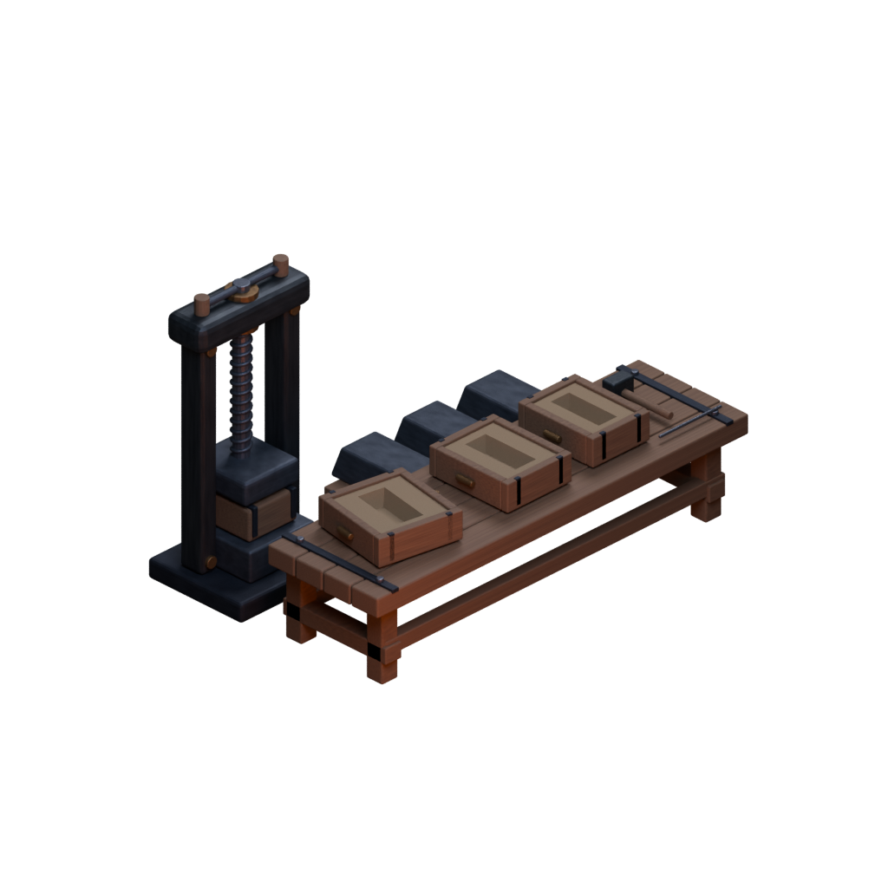

# Casting bench kit

Native Blender study for the existing casting shelf. The kit contains a supported oak moulding bench, a compact hand screw press at the western rear, two working sand flasks, a removed flask half set aside at an angle, three cooled billets, and two hand tools. The sand cavities are tapered Boolean cuts into real volumes; the screw has a modeled helical thread. There is no ground plane, shadow catcher, emission, or painted geometry.

## Editable source and reproduction

- `casting-bench.blend`: editable native geometry and procedural materials.
- `casting-bench.png`: 1024 × 1024 transparent RGBA render, existing study02 camera direction and lights.
- `projection.json`: measured geometry budget, exact capture projection, equipment bounds, and integration footprint.
- Generator: `Tools/ArtReview/BuildBlenderCastingBench.py`, executed with portable Blender 4.5.9 LTS from `TestResults/tools/blender-4.5.9-windows-x64/blender.exe --background --python Tools/ArtReview/BuildBlenderCastingBench.py` at the repository root.

The generator loads `ArtDirection/2026-10-09/blender-furnace-02/furnace-study.blend`, removes its mesh objects, and reuses its lights and procedural forged iron/old bronze material family. Oak and compacted sand use procedural noise, roughness, and restrained bump; no external texture or downloaded model is used.

## Integration contract

Anchor design coordinates: **(-15.5, 20.75)**. Square orthographic extent: **7**, with local projected bounds **left -3.5, right 3.5, bottom -2.5, top 4.5**. Height compensation is `1 / cos(30°)`; camera offset is `(-12, -12, sqrt(96))`, aimed at a vertical target of `1 × height compensation`. Use the full uncropped image with these bounds; do not derive quad dimensions from alpha bounds.

The existing masonry shelf and depth owner remain **u [-18, -13], v [19.1, 22.4], height 2.5**. All equipment is inset within **u [-17.7, -13.35], v [19.4, 22.1]**; the generator measures evaluated geometry and asserts those limits and the **0.18–2.5** height contract. The original shelf, walking geometry, camera, and gameplay are outside this source's scope.

## Review and limits

The actual rendered image was inspected: open cavities, screw press, supported table, and billet silhouettes are readable; no clipped geometry or baked floor is present. The slightly angled removed half separates it from the working moulds. Dark cool metal and warm wood/sand distinguish the equipment without furnace glow.

This is a fixed-view prop kit, not an accepted Unity/device result. The bench can obscure part of the lower rear billet rack in this intended view. Painter depth, surrounding masonry overlap, on-device scale, and imported texture budget still require integration verification. Fine thread and wood detail will compress at phone scale; the press/table/mould silhouettes carry the identity.
