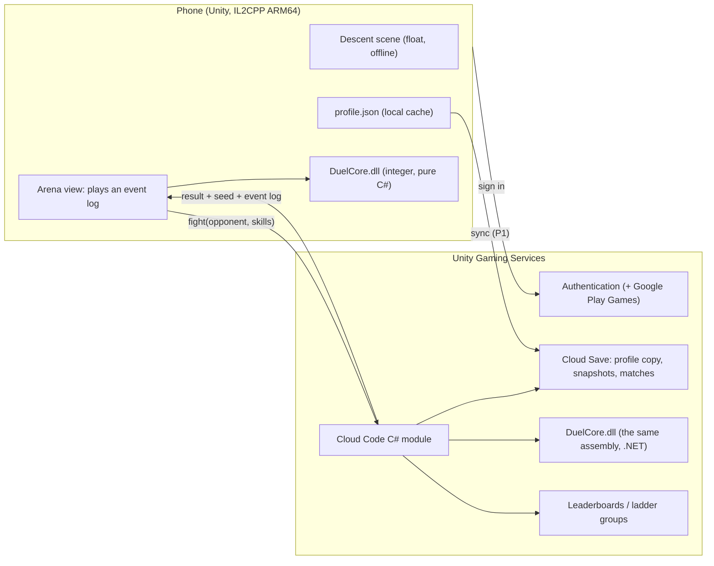

# 55 - The PvP arena: architecture decision (proposal, 2026-11-17)

A proposal for the owner's and the lead's decision. The owner asked "did we design the PvP architecture?": no, until
this document. docs/54 section 14 outlined an async arena in one paragraph and the lead kept it an outline until the
owner confirms it (docs/54 section 17, decision 12). Nothing in the game is built: no code under `Assets/`, no asset,
scene, setting or package changed. One tool is added so the questions that numbers can settle are settled:
`Tools/CombatChecks/ArenaDuel.cs`, a 400-line **integer-only deterministic 1v1 duel** with a small autopilot on each
side, and `ArenaDuelResearch.cs` beside it (its replay test runs in every plain `dotnet test`; the research runs by name,
section "How to re-run"). Numbers cited as "measured" come from it (2026-11-17, main `0243c55d`, seeds 1-2000, this
12-thread Windows machine); costs are the vendors' published prices on the day (sources at the end); every other number
is a starting value. **Since 2026-11-18, section 10 records P0's core as built and measured** (the `Cryptforge.Arena`
assembly, both modes, the local ladder, the arena's balance table).

The earlier docs said "no PvP, no server authority, no live backend" for the MVP (docs/00, docs/01, docs/16) and named
the conditions for a backend (docs/06, "Backend decision": account sync, server-validated purchases, anti-cheat with
financial impact, competitive leaderboards). A ranked arena is exactly those conditions arriving together, which is why
this document is mostly about **what must leave the phone, and when**.

## 0. The short version

| Question | Answer | Key numbers |
|---|---|---|
| Real-time or async? | **Async now, real-time never unless the game grows** (hybrid only as a door left open) | real-time 1v1 needs about **370 players online at every hour** (55 of them in the arena) to match 9 in 10 within 15 s with 6 queues: roughly **110,000 MAU**; async works with **1 player and seeded rivals** |
| What the fight is | **1v1 hero duel, best of three, both sides played by the autopilot** (Archero 2's arena shape), the attacker's 3 skills chosen before the fight | a duel lasts **~27-30 s** (measured, health x8 in the arena); a best of three ~1.5 min |
| Second mode | **The Daily Trial**: everyone plays the same seed (Slay the Spire's Daily Climb), a leaderboard, unranked | costs nothing to build on the shipped Descent; ranked only after the combat core is integer (section 3.3) |
| Why the deterministic sim matters | the server **runs the duel itself**: the result is the server's, the client plays the event log; a replay is **(rules version, seed, two snapshots)** plus a ~1 KB event log | a duel **50-120 us**, a best of three **0.15-0.3 ms** of one core (measured; up to 4x that on a loaded machine): **1 million fights = about 4 CPU minutes** |
| Gear in ranked | **Not raw.** In a build-against-build auto fight a small edge decides almost everything | +5.6 % gear power wins **69-77 %**, a +5 set (+15 %) **90-99 %**, a +9 set **99 %+** (measured, mirror matches) |
| Backend | **Unity Gaming Services**: Authentication (+ Google Play Games), Cloud Save, **Cloud Code C# modules** (the same duel assembly on the server, .NET), Leaderboards | **$0** at 1k MAU, **~$5** at 10k, **~$100-160** at 100k a month (modelled, section 4.2) |
| What leaves the phone | for a **normalised** ranked arena: only the arena's rating, snapshots and rewards; for a **gear-counts** arena: gold, items, basma, efsun, materials, boosters, the anvil's stream, purchases | the second is a 20-25 day project and makes the anvil online-only |
| Phases | **P0** local arena vs generated rivals (no server) - **P1** accounts + cloud save (+ server-owned inventory only if gear counts) - **P2** async ranked ladder with server re-sim - **P3** real-time, optional | P0 **12-15 days**, P1 **8 days** (sync) or **25-30** (server-owned), P2 **15-20 days**, P3 **20-30 days** (one agent + the lead) |

**The recommendation in one paragraph.** Build the arena as an asynchronous 1v1 hero duel whose fight is computed by a
small integer duel core that lives in the game's pure C# (beside `RunRandom` and the shipped rules), compiled unchanged
into a Unity Cloud Code C# module, so the server decides every ranked result and the phone only draws it. Start with a
local arena against generated rivals (P0, no server, ships in the APK), add accounts and cloud save (P1), then the
ranked ladder (P2). Keep gear out of ranked fairness - a normalised or tightly bracketed ladder - unless the owner wants
gear to count there, in which case the economy of docs/54 moves to the server first. Real-time stays a door: the same
integer core runs lockstep over a relay if the game ever has the population.

## 1. The options and what they cost a solo developer

### 1.1 Real-time PvP

| Stack | What it is | Cost to us | Fit |
|---|---|---|---|
| **Unity Netcode for GameObjects + Relay** | Unity's networking, host/client or dedicated; Relay forwards traffic | Relay: first 50 average CCU free, then **$0.16 per average CCU**; dedicated hosting has no Unity home since **Multiplay was deprecated on 2026-04-01** (Matchmaker, Relay and Lobby continue) | state sync is wrong for a 60 Hz deterministic horde; a duel could be host-authoritative, which is cheatable |
| **Photon Fusion / Quantum** | Fusion: state sync with prediction; Quantum: deterministic fixed-point ECS with rollback, server-side input relay | **100 CCU free** (Fusion/Quantum only), 500 CCU **$125/month**, 1,000 **$250**, 2,000 **$500**, then about $0.50 per CCU | Quantum is the industrial version of what we already do (deterministic, fixed point) but the combat would be **rewritten in Quantum's ECS**: months, and a second copy of every rule |
| **Mirror / FishNet** | open-source Unity networking | free; you host the server (a VPS or Edgegap at ~$0.03-0.07 per vCPU-hour) | the server, its uptime and its anti-cheat are ours |
| **Nakama** | open-source game server (accounts, matchmaker, authoritative matches in Go/TypeScript/Lua) | self-hosted: a VPS and Postgres; Heroic Cloud prices by CPU (about **$13.33 a CPU-day** on AWS Marketplace, ~$400/month a CPU) | authoritative match code is **not C#**: the duel core would be ported |

What real-time asks that async does not:
- **Latency on phones.** Field measurements put 4G round trips at 25-95 ms with 12-24 ms jitter. A melee duel
  under rollback or input delay is playable but must be designed for it; our combat (auto-attacks, a joystick, one
  ability button) would feel the delay in the joystick first.
- **Rollback or prediction** in the scene, and a **server that simulates** to stop a modified client: hosting that runs
  every live match.
- **Population.** A 1v1 queue needs another compatible player to arrive while the first waits. With a 30 s fight and
  30 s between fights, a 15 s wait and 6 queues (3 brackets x 2 regions), 9 matches in 10 need a queue entry every
  6.5 s in each queue (1 - e^(-15/6.5) = 0.9): about **55 players in the arena, 370 online at 15 % in the arena - at
  every hour**, and the off-peak trough is about a third of the peak. Modelled as a mobile game typically runs (DAU 20 %
  of MAU, 30 minutes a day, a peak 2.5x the mean, so peak CCU is about 1 % of MAU), that is about **110,000 MAU**; with
  tighter skill matching (20 queues) about 350,000. Awesomenauts' developer
  estimated far more for team games; a hosting vendor's guidance puts a 100-CCU game at 15-minute waits. Below that
  population the queue fills with bots - an async fight in disguise.
- **Anti-cheat** for a client that sends inputs, **matchmaking**, regions, reconnects, and a match that cannot be
  paused when the phone rings.

For a solo developer with no live audience yet, real-time is a second game to build and to staff. It is not
recommended now (question 1).

### 1.2 Async PvP: what the genre actually ships

| Game | Shape | Who plays the defender | Where the fight is decided | Lesson for Cryptforge |
|---|---|---|---|---|
| **Archero 2** (Habby) | Arena: 1v1 against another player's setup, **automatic**, **best of three**; each round both sides get **three random skills of the same quality**; gear and runes count; tickets; weekly seasons with groups of 50-200 and promotion/demotion | the game's AI | not published | the closest reference: a survivor-like's PvP is an auto-duel you watch, made varied by dealt skills; gear counting makes it a spending contest |
| **Hero Wars** (Nexters) | Arena teams, battles automatic | AI | **the server calculates the result; the battle shown is a recording** (Nexters support) | the server-authoritative async model, stated by a shipped game |
| **AFK Arena** (Lilith) | Arena of Heroes: a defence formation and an attack formation, a season timer, replays of losses | AI | not published | replays as a learning tool |
| **Summoners War** (Com2uS) | Arena, Siege, Guild Battles all asynchronous: set a defence, attack others' AI-controlled defences; season ranking | AI | not published | async scales to a 10-year game |
| **Raid: Shadow Legends** (Plarium) | Classic Arena 4v4 against a pre-selected defence; tiers Bronze to Platinum; AI settings per defence | AI (configurable) | not published | the defender's AI policy is part of the build |
| **Clash of Clans** (Supercell) | attack a base; replays are **re-simulated from the recorded actions**, not video; a 2026 replay bug came from boosts the replay did not register | the base's rules | the live result is authoritative, the replay a re-run | a replay is inputs plus a deterministic simulation; anything outside the simulation (a boost) breaks it |
| **Diablo Immortal** (Blizzard) | real-time Battlegrounds with **stat compression** and a capped Combat Rating, still widely called pay-to-win | players | servers | compression alone does not make gear-based PvP fair |
| **Slay the Spire** Daily Climb, **Puzzle & Dragons** Ranking Dungeons | everyone plays the **same seed** (or dungeon); a score leaderboard; rewards by percentile | - | the client's claim; P&D disqualifies abnormal scores | the "race" is the cheapest fair mode there is; the risk is cheated scores |
| **Vampire Survivors, Megabonk** (docs/40) | no PvP | - | - | the genre's core does not need PvP; it is a retention layer |

### 1.3 The hybrid

Async now and real-time later is cheap **only if** the fight runs on a deterministic integer core from day one: the
same core then runs **lockstep** (both phones simulate, only inputs travel) over a cheap relay (Unity Relay, $0.16 per
CCU past 50), with a server re-running the inputs for disputes. In a duel where the autopilot moves and strikes and the
player's only inputs are three skill buttons, lockstep's input delay (100-150 ms) is invisible: nobody aims. A float
core cannot do this across x64 and ARM (section 2.2). So P0's integer core is also the real-time option's price of entry.

## 2. Why our deterministic simulation matters

### 2.1 What it buys

1. **The server decides, the phone draws.** In an auto-duel neither side sends inputs during the fight. The server
   takes the attacker's snapshot, the defender's snapshot and a seed it draws itself, runs the duel, stores the result
   and returns the event log; the phone animates the log. There is nothing to cheat in the fight: a modified client can
   only change what it shows itself.
2. **Cheap.** Measured: a duel of ~27 s costs **50-120 us** of one core (the spread is this machine's load), a best of
   three with dealt skills **0.15-0.3 ms** (up to 4x that while the machine was busy). A million ranked fights a month is
   about **4 CPU minutes**. On Cloud Code the invocation's overhead, not the fight, is the bill (section 4.2).
3. **Replays are data, not video.** A duel is (rules version, seed, attacker snapshot, defender snapshot); its event log
   is about **125 events, ~1 KB**. "Watch the replay" is "play the log" - the same view as the live fight.
4. **The same tests.** The duel core is pure C#, so `Tools/CombatChecks` measures the arena the way it measures the
   Descent: round-robin matrices of every hero and skill, the gear curve, a patch's effect on stored results.
5. **Bit for bit.** Measured: 2,000 duels sequential and again in parallel give 2,000 identical fingerprints (the
   replay test pins 200 in every plain `dotnet test`).

### 2.2 Why integers (and why the Descent's simulation is not the arena's core)

The Descent's simulation (`DescentSimulation`) is a **float** mirror of the scene, kept honest by
`SimulationParityTests` with a 1-point health tolerance. That is right for balance research and wrong for verification:
- Unity does not promise float determinism across architectures; IL2CPP keeps single precision where Mono promotes to
  double, and Unity's issue tracker shows Mono and IL2CPP disagreeing on Apple Silicon. A server re-simulating on x64
  .NET what a phone played under IL2CPP on ARM64 can drift, and a horde fight is chaotic: one different target and the
  runs part. The project paid for this once already (docs/21, the movement budget; `RunRandom`'s note).
- Photon Quantum, the industrial deterministic engine, uses fixed point for exactly this reason.

So the **arena's core is integer-only** (milli-points, milli-units, 60 ticks a second, chances per mille, `RunRandom`
streams). The prototype shows it is small: one file, no allocation in the loop. The Descent's float simulation stays the
balance tool.

Where a float core is enough: when the server computes and the phone only plays the server's log, cross-architecture
determinism is not needed at all. The integer core is needed for **(a)** an offline/local arena whose results a server
later trusts, **(b)** player inputs during the fight (tapped skills, real-time lockstep), **(c)** re-running old matches
on a newer server. All three are in the plan, and integers cost nothing extra in a 400-line core.

### 2.3 Anti-cheat for local saves: what must move before ranked

Today the profile is `profile.json` beside the app (`ProfileStore`, `JsonUtility`, version 3; docs/54 proposes version
4 with items, materials, boosters and the anvil's stream). It is plain JSON: anyone who can read app storage can give
themselves 39,491 gold, a +9 set or the next anvil draw (docs/54 4.3: `anvilSeed` and `anvilDraws` in the profile make
the next roll predictable to whoever reads the file).

What must be server-owned depends on **whether gear counts in ranked** (question 5):

| If ranked is... | Must be server-owned | Can stay local |
|---|---|---|
| **Normalised** (gear does not change the duel's stats; build = hero, weapon, 3 skills, arena talents) | the arena's rating, tickets, snapshots, match history, arena rewards and their ledger | gold, items, basma, efsun, materials, boosters - PvE is single-player and stays offline |
| **Gear counts** (raw, compressed or bracketed) | everything that makes gear: **gold, items, basma levels and pity, efsun lines, materials, boosters, the anvil's seed and draw count (server-only), purchases**; and **run rewards**, claimed through the server with plausibility caps | settings, cosmetics, telemetry |

The second column of the second row is the hard part: a run is played on the phone, by the scene, with a joystick, and
cannot be re-simulated by the server (2.2). Its rewards can only be **bounded**, not verified: gold per completed run
is measured at about 500 with a P25-P75 of ±10 (docs/54 section 1), items about 1.5 a run, a run lasts at least ~7
active minutes, so the server caps a claim by floors cleared and elapsed time, rate-limits runs, and flags outliers. That
is the standard defence of single-player-with-PvP mobile games and it is imperfect. The anvil and efsun rolls move
to Cloud Code (the server holds the stream; the phone never sees the seed), and **the anvil becomes online-only**.

**Purchases.** Any real-money purchase of currency or power needs receipt validation on a server regardless of PvP
(docs/06's own condition). If the owner plans IAP (question 3), P1's server-owned inventory is needed anyway and the
choice above is cheaper to make once.

## 3. The arena's gameplay

### 3.1 Four shapes, scored

| Shape | Fair? | Readable on a phone? | Cost | Verdict |
|---|---|---|---|---|
| **1v1 hero duel** (snapshot vs snapshot, both autopiloted, best of three) | as fair as the stat rule (3.4) | yes: two heroes, two bars, three skill call-outs, ~30 s a round | small: integer core, a lane, playback of existing hero art | **recommended** |
| **1v1 with each side's horde** (my horde attacks you while yours attacks me) | hard to balance; the horde's 30-40 crowd is the Descent's tuning | no: two crowds on one 1080-wide portrait screen | large: a second horde balance, a float sim to port to integers | no |
| **Race: who clears the same seeded wave faster** | the fairest: same seed, same content, your hands and build | yes: it is the game itself, with a ghost bar | **zero** to build unranked (the Descent and its seeds exist); ranked needs the whole combat in integers | **yes, as the unranked Daily Trial** (3.3) |
| **3-hero teams** (AFK Arena, Raid) | as 3.4 | crowded with three a side | needs heroes we do not have (two shipped, the Riftblade proposed, docs/46) | later, if the roster grows to 6+ |

### 3.2 The duel, as proposed

- **The lane.** A straight lane 12 units wide (the prototype's), the heroes entering at ±4; melee closes, the staff keeps
  its reach. Health x8 for both sides (an arena-only knob: a run's hero dies to a level-1 foe in 5 s, no duel should),
  a 90 s limit, the larger share of health left winning at the limit.
- **Both sides autopiloted**, as the async genre does it. The attacker chooses **3 active skills** before the fight: the
  hero's own ability plus two (docs/54 section 14's second and third skills); the defender's are its saved snapshot's.
  P2b can let the attacker **tap its own skills** during the fight (inputs recorded as tick numbers, verified by the
  server's re-run): the one live decision that makes watching a fight playing it.
- **Best of three, each round dealing both sides two skills of the same quality from a shared pool** (Archero 2's
  device), so two equal builds do not replay the same fight. Measured: it softens the gear curve only a little (3.4);
  its job is variety, not fairness.
- **What makes it readable**: the skill call-out over the caster (name, icon, 0.8 s), a damage number on a crit, two
  health bars with the shield drawn over them, a round counter, and after the fight a 3-line "why": "Bulwark absorbed
  1,140", "Cleaving Arc crit twice", "Ilya kited 6 s". The event log already holds all of it.
- **The defender's policy** is part of its build (Raid's AI settings): careful (shield early) or bold (skills on
  cooldown) - two of the autopilot's existing cohort habits.

**The first balance finding (measured): PvE balance is not PvP balance.** At equal gear the Vanguard beats Ilya in
**98-100 %** of duels (her kiting runs out of lane; the Sword's 22.5 DPS beats the Staff's 21.8 on 10 % more health).
Every arena needs a second balance table - per-hero arena coefficients (health, damage, reach in the lane) tuned by
a round-robin matrix in `CombatChecks` - and every new hero or skill pays that tuning again. It is a recurring cost,
not a one-off.

### 3.3 The Daily Trial (the race)

Everyone gets the same seed each day (and a weekly one with a modifier), plays one floor or the whole Descent with any
hero, and posts a clear time to a leaderboard; rewards by percentile, cosmetic. It costs a seed derived from the date
(`RunSeeds`), one leaderboard and a result screen line. It is **unranked by design** until the combat core is integer
(2.2): a human-played run cannot be re-simulated, so the server can only cap implausible times (a floor-1 clear under
the measured fastest) and Slay the Spire's own Daily Climb shows the leaderboard will attract cheaters. Measured, the
Descent's floor 1 re-simulates in **~0.5 s** of one core with identical results in parallel, so verifying an
**autopiloted** race (your build, your autopilot, the same seed) is affordable even now - a "ghost race" variant if the
owner wants a race that ranks.

### 3.4 Gear in a build-against-build fight (measured)

A geared side A against an ungeared B, 2,000 seeds a cell, draws counted half; the gear sets are docs/54 section 7.2's,
the power its index (DPS x EHP - 1):

| A's gear | Gear power | Vanguard mirror: duel / Bo3 | Ilya mirror: duel / Bo3 | Ilya (A) against the Vanguard: duel / Bo3 |
|---|---|---|---|---|
| none | 0 % | 49.5 % / 48.6 % | 48.3 % / 49.2 % | 0.2 % / 1.9 % |
| a small edge (+2 % damage and health) | +5.6 % | **72.7 % / 68.9 %** | 77.1 % / 75.3 % | 1.4 % / 6.9 % |
| all four at +5 | +14.7 % | **98.7 % / 90.4 %** | 95.6 % / 91.3 % | 11.5 % / 20.7 % |
| all four at +7 | +21.0 % | 99.9 % / 96.4 % | 98.8 % / 97.3 % | 34.3 % / 40.8 % |
| all four at +9 | +30.9 % | 100 % / 99.3 % | 100 % / 99.1 % | 76.6 % / 71.4 % |
| +9 with good efsun | +41.9 % | 100 % / 99.9 % | 100 % / 99.9 % | 97.3 % / 91.8 % |
| the ceiling | +50.6 % | 100 % / 100 % | 100 % / 100 % | 99.7 % / 97.3 % |

An auto-fight **amplifies** a stat edge: there is no outplay to cancel it. A +5 set (about 7 careful runs of gold and
Ember Shards, docs/54 4.1) wins 9 fights in 10 against an ungeared player; a +9 set (135 runs) wins all of them. docs/54 section 14's
matchmaking by "gear power bands of ±10 %" would still hand the stronger side **70-85 %**. Dealt skills (Bo3) move
it a few points. Three ways out:

1. **Normalised ranked** (recommended): the duel ignores gear's stats; the build is the hero, its weapon, three skills
   and a few arena talents unlocked by playing. Gear shows as cosmetics in the arena. No pay-to-win, and the local
   save's economy never touches fairness (2.3).
2. **Brackets**: gear counts, matchmaking within **±3 %** gear power (the small edge's ~70 % at 5.6 % is the ceiling of
   "fair enough"), leagues per bracket. Splits a small population six ways and needs server-owned gear.
3. **Compressed**: gear counts at a quarter in the arena, capped at +10 % (Diablo Immortal's stat compression). A +10 %
   edge still wins ~85 %; compression postpones the problem rather than solving it.

An **Open arena** (gear counts, casual rewards only, matchmaking by gear power) can sit beside a normalised ranked
ladder for players who want their +9 to matter (question 5).

### 3.5 Leagues, seasons, rewards

- **Weekly leagues in groups** (Archero 2: groups of 50-200, promotion and demotion each week): a group is formed from
  whoever is active this week, so it works at any population; a hidden Glicko-2 rating picks opponents (3-5 offered,
  refreshable), **5 tickets a day**.
- **Seasons of 4 weeks**, aligned with balance patches (3.6): a season's ranking, a frame or title, a weapon skin.
- **Rewards that feed PvE without inflating it**: cosmetics first; then the boosters docs/54 already prices, in bounded
  amounts - a week's top group about **2 Forge Seals and 3 Efsun Scrolls** (a careful run earns 0.43 Seals and 0.97
  Scrolls, so a week's best is about 5 runs' worth of boosters, and the Seal's bonus, not its count, is the knob -
  docs/54 section 5); **no gold beyond small amounts, no items, no materials** (materials are the depth gate, docs/54
  4.2). The arena must never be a faster road to +9 than the Descent.
- Bots (generated rivals at fixed gear powers, section 6's P0) fill a group below 20 real players and are labelled.

### 3.6 Versioning: a match must replay identically after a balance patch

Measured: a **2 % Sword patch changes the winner of 3.0 %** of stored Vanguard mirror duels and **9.4 %** of the closest
cross-hero pair, and the fingerprint of every one. So "a replay is the seed and two builds" is only true with the
**rules version** pinned:

- A **snapshot stores ids and levels**, never resolved stats (hero, weapon, the three skill ids, gear ids, basma levels,
  efsun line ids and tiers - docs/54's save already stores a line's tier, not its value). A defender's snapshot is
  **re-resolved at fight time** under the current rules, so a nerf applies to every defence at once.
- A **match stores** the rules version, the rules' content hash, the seed, both **resolved** snapshots (a few hundred
  bytes), the result and the **event log**. Watching an old replay plays the log - no re-simulation, any client version.
- The **duel core is versioned** (`DuelRules.Version`, an integer bumped by any change that can move a result) and the
  server keeps the current and the previous season's core loadable, for audits and disputes within a season.
- The **event log's schema is versioned separately** and changes rarely; an old client that cannot read a newer log
  is told to update.
- A season starts on a rules version and ratings carry over with a soft reset; balance patches land between seasons
  where possible.

## 4. Backend options for async and accounts

### 4.1 What we need

Accounts (anonymous first, linked to Google Play Games), a cloud copy of the profile, server code that can run **our C#
duel core**, small JSON documents (snapshots, matches), leaderboards or a ladder, and later receipt validation.
Offline play must keep working: the Descent never needs the network; only the arena and (if gear counts) the anvil do.

### 4.2 Monthly cost (modelled)

Usage model per daily player per day: 30 server calls (5 fights, 3 opponent lists, 10 anvil/efsun, 4 run claims, 8
other), 0.1 s of compute each, 15 save writes and 30 reads, ~30 KB stored a player; DAU = 20 % of MAU; 30 days.

| Option | 1k MAU | 10k MAU | 100k MAU | Runs our C# core? | Notes |
|---|---|---|---|---|---|
| **Unity Gaming Services** (Auth, Cloud Save, Cloud Code, Leaderboards) | **$0** | **~$5** | **~$100-160** | **yes**: Cloud Code C# modules on .NET (up to 9), no `UnityEngine` | Authentication free; Cloud Code 1M calls and 20 compute-hours a month free, then $1.50/M and $0.00002/s; Cloud Save 1M writes and reads free; Leaderboards free "for a limited time" (a localised page lists 50k MAU free, then $0.00125 a MAU: up to ~$60 of the 100k figure); module limits 256 MB, 10 MB a module |
| **PlayFab** (pay-as-you-go) | ~$0-5 | ~$15-25 | ~$150-200 | yes (CloudScript on Azure Functions, C#) | development mode is now **1,000 lifetime players a title**; profile writes $7.15 per million 1-KB blocks dominate; the Azure Functions app is a second bill |
| **Firebase** (+ Cloud Run for C#) | $0 | ~$0-5 | ~$45-80 | via a Cloud Run container | Auth free for most providers; Firestore ~$0.18 per 100k writes; Functions 2M calls free then $0.40/M (Node/Python); no ladder service: we build it |
| **Supabase** | $25 | $25 | ~$25-60 | no (Edge Functions are TypeScript): a separate C# host +$5-30 | Pro plan $25 includes 100k MAU and 2M function calls; Postgres is a real database |
| **Nakama** | ~$10-40 self-hosted | ~$10-40 | ~$40-80 + ops | no (Go/TS/Lua): port the core | Heroic Cloud ~$400 a CPU-month: too large for us |
| **Own minimal server** (ASP.NET Core minimal API + Postgres on a VPS) | ~$10-20 | ~$10-20 | ~$30-60 | **yes, natively** | cheapest at scale; every security patch, backup, TLS renewal, DDoS and 3 a.m. outage is ours: +10-15 days to build and a standing monthly cost in time |
| *Real-time, for comparison:* Photon Fusion/Quantum | free (100 CCU) | free-$125 | $125-250 | Quantum only (its own FP ECS) | plus the rewrite (1.1) |

**Recommendation: Unity Gaming Services.** It is the only managed option where the **same C# assembly** runs on the
phone and on the server without a port; it is free at our current scale, around $5 at 10k MAU and around $150 at 100k;
its Authentication supports Google Play Games sign-in (the Play Games v2 SDK signs in silently at launch; Unity's
`SignInWithGooglePlayGamesAsync` creates or finds the player); and it is in the editor the project already uses. The
risks: vendor lock-in (Unity deprecated Multiplay in 2026 - services do get withdrawn), Leaderboards' price after the
promotion, and Cloud Code's per-call limits. Mitigation: the duel core and the ladder logic are plain C# with no UGS
types in them; a move to an own ASP.NET server is a host change, not a rewrite.

### 4.3 Players' data: GDPR, KVKK, Google Play

- **What we would store**: a pseudonymous player id, a display name, the Google Play Games link, snapshots, match
  history, rating, the profile copy; telemetry only if it is ever sent (today it never leaves the device, docs/10).
  No email, no real name, no location beyond a coarse region for matchmaking.
- **Google Play**: an app that lets users create an account must offer **deletion in the app and through a web link**
  (deactivation does not count) and declare it in the Data safety form. An anonymous UGS account counts once it syncs.
  P1 ships "Delete my account" in settings and a web form (a page with a form or an email address suffices).
- **GDPR** (EU players): a privacy policy naming the processor (Unity), the purposes (save sync, PvP), retention
  (match history 90 days, the account until deleted), export on request; the processor's data-processing terms.
  Under-16s: the game is not aimed at children; the store rating and the policy say so.
- **KVKK** (Turkey, where the developer and many players are): the developer is the data controller; storing on Unity's
  servers abroad is a cross-border transfer, which since the 2024 amendment (Law 7499, the regulation of 10 July 2024)
  rests mainly on **standard contracts notified to the Authority within 5 business days** of signing (fines are
  stated); VERBIS registration has thresholds and exemptions set by the Board - **to be checked with a Turkish privacy
  lawyer before P1 ships** (question 7). An aydınlatma metni (information notice) in Turkish beside the privacy
  policy.
- **Offline keeps working**: the profile stays on the phone as the cache; sync is "last writer wins per field, the
  server's arena data always wins"; no network, no arena, everything else as today.

## 5. The recommended architecture

### 5.1 Picture



- **One assembly, two hosts.** `Cryptforge.Arena` (a new asmdef with `noEngineReferences`, like the pure rules): the
  integer duel core, the snapshot resolver, the arena rules table, the event-log writer, `RunRandom`. Unity compiles it
  into the APK; the Cloud Code module references the same source files (a `.csproj` with `Compile Include`, as
  `Tools/CombatChecks` already does for the simulation); `CombatChecks` tests it. A CI check builds all three and
  compares fingerprints of a fixed batch of duels.
- **The phone never decides a ranked result.** Locally (P0) it runs the core itself; in ranked it plays the server's log.

### 5.2 Data model (Cloud Save documents; JSON, camelCase, versioned like the profile)

| Document | Key fields | Owner |
|---|---|---|
| `player` | `playerId`, `displayName`, `createdAt`, `region`, `consentVersion`, `playGamesLinked` | server (written by Cloud Code) |
| `inventory` (P1, only if gear counts) | docs/54's version-4 fields: gold, `items[]`, `weaponGear[]`, materials, boosters, `anvilDraws`; **`anvilSeed` server-only** | server |
| `snapshot` | `snapshotId`, `playerId`, `heroId`, `weaponId`, `skills[3]`, `gear[]` (ids, levels, line ids and tiers), `policy` (careful/bold), `rulesVersion`, `gearPower`, `createdAt`, `hash` | server (the client proposes, the server resolves and validates) |
| `match` | `matchId`, `seasonId`, `attackerId`, `defenderId`, both snapshot hashes and resolved snapshots, `seed` (server-drawn), `rulesVersion`, `rulesHash`, `inputs[]` (P2b taps), `winner`, `rounds[]`, `eventLog` (~1 KB, compressed), `ratingDelta`, `createdAt` | server; kept 90 days |
| `ladder` | `seasonId`, `league`, `groupId`, `playerId`, `rating`, `deviation` (Glicko-2), `points`, `wins`, `losses`, `ticketsLeft`, `ticketsResetAt` | server |
| `season` | `seasonId`, `startsAt`, `endsAt`, `rulesVersion`, reward table | server (config) |

### 5.3 API sketch (Cloud Code module endpoints)

| Call | Does | Phase |
|---|---|---|
| `Arena.SetDefence(heroId, weaponId, skills[3], policy)` | resolves the build from rules (and server inventory when gear counts), stores the active snapshot | P2 |
| `Arena.Opponents()` | 3-5 snapshots near the player's rating in its group, bots below 20 players; free refresh | P2 |
| `Arena.Fight(opponentSnapshotId, skills[3], inputs[]?)` | spends a ticket, draws the seed, runs `DuelCore` (best of three), stores the match, updates both ladders, returns result + seed + log | P2 |
| `Arena.Replay(matchId)` | the stored log | P2 |
| `Ladder.Group()`, `Ladder.Season()` | standings, rewards | P2 |
| `Profile.Sync(profileDelta)` | cloud copy of the local profile (PvE stays local-authoritative) | P1 |
| `Economy.Strike(itemUid, seal, hammer)`, `Economy.Efsun(itemUid, paidWith)` | docs/54's `AnvilRule`/`EfsunRule` on the server's stream | P1, only if gear counts |
| `Economy.ClaimRun(runId, seed, heroId, floors, activeSeconds, loot)` | plausibility caps, rate limit, credit | P1, only if gear counts |
| `Store.Validate(receipt)` | Google Play receipt check, grant | with IAP |
| `Account.Delete()` | erases every document of the player | P1 |

## 6. Phased plan (one agent + the lead; days of work, not calendar)

| Phase | Work | Size | Done when | Server cost |
|---|---|---|---|---|
| **P0 - local arena** | `Cryptforge.Arena` asmdef: the integer core grown from the prototype (skills from docs/54 14, the hero kits, arena coefficients); snapshots of the player's own builds; **generated rivals** at fixed gear powers and the player's past snapshots; the arena view (lane, the two heroes' existing puppets, bars, call-outs, Bo3) playing the event log; a local "ladder" of 30 rivals; round-robin balance research and the per-hero coefficients; telemetry `arena_fight` | **12-15 days** (core 3, view 5, UI 3, tuning and tests 3, device 1) | the owner plays 10 duels on the S23 and says whether watching is fun (the go/no-go for P2) | $0 |
| **P1a - accounts and cloud save** | UGS Authentication (anonymous + Google Play Games link), profile sync with offline cache, account deletion (app + web), privacy policy and KVKK notice, Data safety | **8 days** + the owner's legal admin | a reinstall restores the profile; deletion erases it | $0 at 1k MAU |
| **P1b - server-owned inventory** (only if gear counts in ranked, or IAP) | `inventory` on the server, migration of the local profile (once, capped), Cloud Code anvil/efsun/claim with plausibility caps, the anvil online-only, receipt validation if IAP | **+17-22 days** | a modified `profile.json` changes nothing on the server; the anvil's odds match docs/54 4.1 from server telemetry | ~$5 at 10k MAU |
| **P2 - async ranked ladder** | the Cloud Code module with `DuelCore` (same sources), snapshots, opponents, fight, Glicko-2, weekly groups, seasons and rewards, replays, bots, rate limits; the CI fingerprint check (phone build = server build); a closed test with ~50 players | **15-20 days** + a test week | 1,000 server fights match the phone's local re-run bit for bit; a season runs end to end | ~$5 at 10k, ~$100-160 at 100k MAU |
| **P2b - tapped skills** (optional) | the attacker presses its 3 skills; inputs travel as tick numbers; the server re-runs them | **5 days** | a tapped fight replays identically on the server | same |
| **P3 - real-time duel** (optional, from ~100k MAU) | lockstep 1v1 over Unity Relay with the integer core, input delay, reconnect = the autopilot takes over, a server re-run for disputes; or Photon Quantum (a rewrite, 60+ days) | **20-30 days** + live operations | 9 in 10 matched within 15 s at the trough | Relay $0.16 per CCU past 50 |
| **Daily Trial** (any time after P1a) | a date seed, one leaderboard, the result line; unranked, plausibility-capped | **3-4 days** | a day's board fills | Leaderboards (free today) |

Order: **P0 first and alone** - it costs no server, ships in the APK, and answers the only question that matters before
any backend money: is watching a duel fun on a phone? docs/54's phases 1-3 (items and the save's version 4) come
before P1b; the three active skills (docs/54 14) before P0's skill choice, or P0 starts with the hero's ability plus
two pool skills.

### 6.1 Risks

| Risk | Likelihood | Effect | Mitigation |
|---|---|---|---|
| Watching an auto-duel is not fun on a phone | medium | P2 is wasted | P0 is the gate; tapped skills (P2b) and the "why" summary |
| Gear makes ranked pay-to-win (3.4) | high if gear counts | reviews, churn | normalised ranked; an Open arena for gear |
| PvP balance drags every new hero and skill (3.2) | certain | a recurring tuning task | round-robin matrix in `CombatChecks`, per-hero arena coefficients separate from PvE |
| Cheated local saves reach the ladder | certain if gear counts and P1b is skipped | an unfair ladder | do not let gear count before P1b; normalised ranked needs no inventory |
| Phone and server cores drift | low with integers | wrong replays, disputes | one source set, CI fingerprint check, `DuelRules.Version` |
| A balance patch rewrites stored outcomes (3.6) | certain without pinning | disputes | matches store the log and the rules version |
| Vendor withdraws a service (Multiplay, 2026) | low-medium | migration | no UGS types in the core or the ladder logic |
| Population too small for a lively ladder | high at launch | empty groups | weekly groups of whoever is active, labelled bots, async needs one player |
| Legal: KVKK/GDPR, account deletion | certain once accounts exist | store rejection, fines | P1a's checklist and a lawyer's hour before launch |

## 7. Questions for the owner

1. **Real-time or async?** This document recommends **async** (an auto-duel the server decides) now, and real-time
   only if the game reaches ~100k monthly players. Do you want real-time at all, and does "you fight another player's
   saved hero, played by the AI" feel like PvP to you?
2. **What should the arena feel like?** (a) a **duel** of two heroes, best of three (recommended); (b) a **race** on
   the same seed (the Daily Trial; fair and cheap, unranked at first); (c) **teams** of three heroes later. Should the
   attacker **tap its own skills** during the fight (P2b), or only choose them?
3. **Monetisation.** Will the game sell anything for real money - currency, boosters, items, a battle pass, or only
   cosmetics and ad removal (docs/11)? Selling power or currency means server-owned inventory and receipt checks no
   matter what PvP does.
4. **Server budget.** Is about **$5 a month at 10,000 players and $100-160 at 100,000** acceptable, and do you accept
   Unity's services (accounts on Unity's servers abroad) over running our own server?
5. **Gear in ranked.** Should a +9 set win ranked fights? Measured, an auto-fight hands a +5 set 9 wins in 10 and a +9
   set all of them. Options: **normalised ranked** (gear does not count; recommended), **brackets** by gear power,
   or gear counts openly - and an **Open arena** where gear counts, beside ranked?
6. **Online-only anvil.** If gear counts, the anvil and efsun must roll on the server: no basma without a connection.
   Acceptable?
7. **Accounts and law.** Are you ready to publish a privacy policy and a KVKK notice, sign Unity's data terms, add
   "Delete my account", and pay for an hour with a Turkish privacy lawyer before accounts ship?

## 8. Questions for the lead

1. **The integer arena core** as its own asmdef (`Cryptforge.Arena`, no engine references), separate from the
   Descent's float simulation, which stays the balance tool. Agree?
2. **The server decides ranked results**; the phone plays the log; local runs only in P0 and for prediction. Agree?
3. **Snapshots store ids and levels**, re-resolved at fight time; matches store the rules version and the log (3.6).
4. **Per-hero arena coefficients** as a second balance table, tuned by a round-robin research in `CombatChecks`.
5. **P0 before any backend**, with the owner's S23 verdict as the gate for P2.

## 9. The owner's answers and the lead's decisions, 2026-11-18

The owner researched monetisation and arena fairness across nine games of the genre and the Turkish market
(`docs/research/2026-11-18_monetisation_and_arena_owner_report.md`, in Turkish) and answered section 7:

1. **Async, never real-time.** An auto-duel against another player's saved hero, decided by the server once ranked
   exists. P3 (real-time) is dropped from the plan.
2. **A duel, best of three. Automatic first:** the player chooses the build and watches. **P2b (tapped skills) is built
   if the owner's P0 verdict says watching is not fun.** The race (Daily Trial) and teams are not planned.
3. **Monetisation: model B** (docs/58): free, an optional rewarded video at the result screen only, one non-consumable
   "skip reward videos" product at about 99.99 TL. Gold, materials, boosters and efsun are never sold. Since nothing
   bought touches power, **no server-owned inventory** is needed for monetisation.
4. **Server budget:** not needed for the first release (P0 has no server). It is asked again before P1.
5. **Gear in ranked: normalised, with the build's identity kept**, as the owner's report proposes. The ranked duel keeps
   the hero, the weapon's type and attack pattern, the three skills and the **types** of efsun lines the player picks;
   the + level, the number of lines and every line's value are **the same for both sides**. The arena's efsun pool is
   **open to everyone**, so a line type is a loadout choice, not something owned: a rare roll or a +9 never decides a
   ranked fight. Beside it, an **Open arena** (gear counts in full, casual rewards only, matched by gear power).
   The fight's summary names the two or three effects that won it (async players cannot intervene, so the "why"
   matters).
6. **The anvil stays offline.** Follows from 5: nothing the anvil makes decides ranked, so basma and efsun never need
   a connection.
7. **Accounts and law:** not needed for the first release. Asked again before P1, with the privacy policy, the KVKK
   notice and the lawyer's hour.

**The release order:** the first release is the single-player Descent plus **P0, the local arena**: generated rivals and
the player's own past heroes, no server. It ships in the APK. Ranked against real players (P1-P2) follows once the
first release has players.

**The lead's decisions on section 8:** all five as written. The integer core is `Cryptforge.Arena` with no engine
references. The server decides ranked. Snapshots store ids and levels. Per-hero coefficients come from a round-robin.
P0 comes before any backend.

The normalised build of answer 5 refines section 3.4's option 1, which had gear as cosmetics only. P0 builds both modes
on the integer core: **ranked-normalised**, which is the default, and **open**.

## 10. P0's core, built and measured (2026-11-18)

Built on the branch after section 9's answers: the arena's integer core as its own assembly, both modes, the generated
rivals and a local ladder with its own save, the `arena_fight` event's fields, and the research that sets the arena's
balance table. **No view, no UI, no scene, no asset**; the profile, its save and its version are untouched (the arena
keeps its own file), and the Descent is untouched (the default batch re-runs byte-identical but its clocks, below).
Numbers cited as measured come from `ArenaBalanceResearch` (2026-11-18, seeds 1-2000 unless named, best of three,
3 threads of this 12-thread machine while three other agents' simulations ran).

### 10.1 What is built

| Where | What |
|---|---|
| `Assets/_Project/Scripts/Arena/` (`Cryptforge.Arena.asmdef`, `noEngineReferences`, nothing of the game's referenced) | `DuelRules` and `ArenaRules` (the versioned, hashed table: the heroes and their coefficients, the weapons and their patterns and coefficients, the six skills, the ranked pool and its values, the common + level and line count, the boons, the kite's backpedal), `ArenaGearTable` (the gear's tables, copied and pinned equal to `GearStats` and `EfsunRule`), `ArenaRandom` (`RunRandom`'s construction, pinned word for word), `ArenaBuild` and `ArenaSnapshots` (a snapshot's ids and levels, its hash), `ArenaResolver` (re-resolution under the fight's rules, with repairs), `DuelCore` (the duel, best of three), `DuelLog` and `DuelReplay` (the event log and a replay from the log alone), `DuelCredits` and `DuelSummary` (the "why"), `ArenaRivals` and `ArenaLadder` (generated rivals, the local ladder, an integer Elo), `ArenaSaveData` and `ArenaSaveJson` (the arena's own save, version 1, JSON written and read in pure C#), `ArenaFightTelemetry` (the event's fields) |
| `Scripts/Core/ArenaProfileBuild.cs` | the thin bridge: the player's ranked or open build read from `PlayerProfile` (the weapon it carries and owns, the gear `EquippedPieces` gives that weapon); reads, never writes |
| `Scripts/Save/ArenaSaveStore.cs` | the save's file, `arena.json` beside the profile, in `ProfileStore`'s shape (temp, backup, newest revision); System.IO only |
| `Project.Gameplay.asmdef`, `Project.EditModeTests.asmdef` | reference `Cryptforge.Arena` by name |
| `Tests/EditMode/DuelCoreTests.cs`, `ArenaBuildTests.cs`, `ArenaLadderTests.cs` | 24 tests, in Unity's EditMode suite and in every plain `dotnet test` of `Tools/CombatChecks` |
| `Tools/CombatChecks/ArenaBalanceResearch.cs` | the research, on demand (How to re-run) |
| `Tools/UnityCompileCheck/Arena/Cryptforge.Arena.csproj` | the arena's sources compiled alone (netstandard2.1, warnings as errors, no Unity, no game): a stray engine type or a reach into the game fails here as it would in Unity and in a server module; `UnityCompileCheck.csproj` references it as the asmdefs do |

The prototype (`ArenaDuel.cs`, `ArenaDuelResearch.cs`, `HeroSkillsResearch.cs`) is untouched: its report
(`arena-duel.md`, sections 2-3's numbers) re-runs byte-identical but its two clock lines.

### 10.2 The duel as built

Grown from the prototype, in integers only (milli-points, positions in micro-units, 60 ticks a second, chances per
mille; `ArenaRandom` streams per (seed, purpose, index)):

- **The heroes' own three skills** replace the five stand-ins (docs/57 decision 8): the Vanguard's Forge Burst, Iron
  Resolve and Shield Rush, Ilya's Crucible Vent, Flame Sigil and Cinder Ward, at **rank III** (+12 % of each skill's own
  number - damage, the guard's share, the glyph's heat and slow, the ward's size; never the cooldown) and **no cooldown
  line in ranked**. The radii are the run's (the Burst 2.5 and the Vent 3 round the caster, the glyph 2.5, the Rush 4
  units), not "the weapon's reach plus". **The ward reads the hero's own maximum health** (with its health line and a
  Vitality boon): about 20-23 points a ward, never a share of the arena's x8 (pinned by a test).
- **Weapon types and patterns**: the Sword, the Staff and the Daggers at their category numbers; the Staff kites; the
  Daggers crit every third strike for x2 and roll their chance only on the other two (as `WeaponRuntime` does); the
  cleave and the blast are kept for the view (one on one they have no second target). The Vanguard carries all three,
  Ilya the Staff only.
- **The walk, by role** - a kiter backs off from the tick's opening positions, then a side short of its reach closes on
  where the foe now stands - and **a kiter backs off at 60 % of its speed**. The prototype stepped side A first, so a
  kiter on side B could keep a short reach out of range for the whole lane and on side A could not (docs/55's and
  docs/57's numbers are unaffected: the Sword stops at 2.1, outside the Staff's kite trigger at 2.0, so no prototype
  fight ever kited); and a kiter as fast as its chaser keeps whatever gap it opens, so the Daggers (1.8) never reach a
  Staff that kites from 2.0 until the wall: at full speed the Vanguard + Staff beats the Vanguard + Daggers 88 % and Ilya beats it 94 %; at 60 % they
  stand at 48 % and 54 % (10.4).
- **Every point of a hero's output grows with its build**: the strikes, the striking skills, and Ember Memory's burn,
  whose tick grows with the damage, attack speed, crit and burn bonuses (the gear's DPS terms). The run's burn is flat;
  in the lane it is a third of Ilya's damage, and flat it made the hero balance move with the gear level - measured with
  each variant's coefficients calibrated in ranked, Ilya beat the Vanguard + Sword 81 % at no gear and 39 % at +40 %;
  grown, 45-51 % across the range, and Ilya's coefficient settles at 857-859 from + level 3 to 9 alike (10.4).
- **Best of three**, up to five rounds while rounds draw (a double knock-out, about 5 % of mirror rounds, is a drawn
  round); **each round deals each side one boon of the same quality** (Force +6 % damage, Tempo +6 % attack speed,
  Vitality +6 % health, Keen +3 crit points), docs/57's "dealt boons" for variety.
- **Blows land one by one** (the victim's armour, then its guard, then its ward) and every event goes into the
  fingerprint and, when kept, the log; the policies are the prototype's two (careful waits for a skill's moment, bold
  uses it whenever it lands) and part of the build.
- **The "why"** (`DuelSummary`): each side's credits per effect over the match - the damage it dealt by source and the
  damage it kept off itself, with each bonus (a line type in ranked, the gear in the open arena, the round's boon)
  carved out of what it scaled - and the winner's two or three effects ranked by how much more each gave it than the
  same effect gave the loser (the third kept when at least a quarter of the first). Examples from generated rivals:
  "Ember Memory's burn dealt 764 / Crucible Vent dealt 314" (Ilya over the Vanguard), "Iron Resolve turned away 372 /
  Sword strikes dealt 1,502 / Forge Burst dealt 205" (the Vanguard over Ilya), "Damage lines added 72 / Crit lines added
  31" (a narrow Daggers mirror). The lines are English placeholders; the view localises from the effect ids.

### 10.3 The ranked normalisation: the constants and why

| Constant | Value | Why (measured) |
|---|---|---|
| The common + level | **+5** on all four slots (weapon damage +5 %, armour health +5 %, amulet attack speed +2.5 %, ring crit +1.5 points) | once each level is calibrated, **+3, +5, +7 and +9 balance alike** (best build 60-62 %, spread 18-23 points at 300 seeds a build, inside the noise) and fight alike (27-28 s rounds), so the level is not a balance lever; a careful player's first +5 item comes in about two runs and a clumsy one's in five (docs/54 section 9), so +5 keeps the ranked hero near most players' PvE hero |
| Lines a build | **3, distinct types** | the most distinct builds: 10 line choices a Vanguard weapon and 20 for Ilya, 100 builds with the two policies; 2 lines spread about as wide with fewer builds, 4 lines narrow it a little (17.7 points) but leave the Vanguard 5 choices (which one to leave out) |
| Each line type's value (the gear's hundredths) | **damage 300** (the reference), **attack speed 300, crit 325, health 300, armour 275, burn 900** (Ilya only) | the calibration loop (10.4): each type's carriers even with its non-carriers against the field (49.8-51.3 % against 50.1-51.5 %, 10.5) |
| Out of the pool | **move speed**; the **ability-cooldown** line; damage vs elites, area, pickup radius, healing, luck | move speed buys nothing in a lane where a chaser keeps up with a kiter: one move-speed line against one damage line wins **15-28 %** at any value from 5 % to 20 %; the cooldown line by docs/57 decision 8; the rest have nothing to act on one to one |
| Caps | **none in ranked** (the open arena keeps the gear's) | the values are the arena's and the same for both sides; under the gear's caps the crit line stopped counting past 2.5 points over the +5 ring (measured before the change), a type dead at one level and alive at another |
| Skills | **rank III**, no cooldown line | docs/57 decision 8 |
| Boons | **one a side a round** | with them the best build is 60.0 % and 8 builds stand above 55 %; without, 60.3 % and 10 (the variety they add costs nothing in balance) |

One line one on one against the damage line (mirrors, at the shipped values) shows each identity's own taste: crit is
worth 50 % to the Sword, the Staff and Ilya and **34 % to the Daggers** (their rhythm crit never rolls, so a crit chance
works on two strikes in three, as in the run); attack speed 41-50 %; health and armour 48-50 %; the burn line 52 % for
Ilya. A line type is a real choice, and the field still evens out (10.5).

### 10.4 The coefficients

**The calibration loop** (`Normalisation`, section 1): every ranked build against the field a pass (400 seeds a
build), from docs/57's starting point (Ilya x0.8, the Staff and the Daggers untouched, the first guesses at the line
values); each identity's coefficient moves its mean toward the Vanguard + Sword's (about 0.4 points a per mille, damped),
each line type's value moves its carriers toward its non-carriers. It settles in about seven passes; **the shipped table
is the median of the last five**:

| Coefficient (per mille of damage) | Start | Shipped |
|---|---|---|
| The Vanguard, the Sword | 1000 | **1000** (the reference) |
| Ilya (all its damage: strikes, skills, burn; health x1.000) | 800 | **859** |
| The Staff (both heroes) | 1000 | **1023** (so Ilya's Staff deals x0.879 in all) |
| The Daggers | 1000 | **784** |

**The round-robin as shipped** (`Coefficients`, seeds 1-2000, best of three, each side's lines and policy drawn per
seed from its identity's 20 or 40 builds):

| A \ B | Vanguard + Sword | Vanguard + Staff | Vanguard + Daggers | Ilya + Staff | A against the four |
|---|---|---|---|---|---|
| Vanguard + Sword | 49.3 % | 49.8 % | 45.9 % | 49.6 % | 48.7 % |
| Vanguard + Staff | 49.0 % | 49.2 % | 47.6 % | 46.3 % | 48.0 % |
| Vanguard + Daggers | 49.7 % | 47.9 % | 47.1 % | 46.2 % | 47.7 % |
| Ilya + Staff | 49.0 % | 51.2 % | 53.5 % | 48.4 % | 50.5 % |

**Mirrors 47-49 %** (draws count half; a double knock-out ends about 5 % of mirror rounds) and **hero against hero:
the Vanguard against Ilya 47.3 %, Ilya against the Vanguard 51.2 %** - inside the 45-55 % target. Every pair stands in
45.9-53.5 %. Uncoefficiented (all at x1.000) the same matrix runs from 0.0 % to 100 %: the Daggers win nearly every fight,
Ilya beats the Sword and the Staff Vanguards 99 %.

**How steep it is**: ten per mille on one coefficient moves that identity's mean **5-8 points** (the Staff 43.6 / 48.0 /
53.7 % at -10 / 0 / +10, the Daggers 40.0 / 47.7 / 55.8 %, Ilya 43.3 / 50.5 / 58.3 %) - so the table keeps them to the
per mille, and any change to a hero, a skill or a weapon is re-calibrated, not guessed.

**The kite's backpedal** (shipped coefficients): at full speed the Vanguard + Staff beats the Vanguard + Daggers
**87.8 %** and Ilya beats it **94.1 %** (the Daggers' mean against the four 28.4 %); at 80 % 52.2 % and 58.6 %; at
**60 % (shipped) 47.6 % and 53.5 %**; at 40 % nearly the same as 60 %. The Sword's pairs do not move (it stops at 2.1,
before the kite's trigger at 2.0).

**The burn that grows** (`OpenCurve`, equal gear on both sides, each variant's coefficients calibrated in ranked the same
way - the flat burn settles Ilya at x0.905): with the run's flat burn Ilya beats the Vanguard + Sword **81 % at no gear,
66 % at +10 %, 50 % at +25 %, 39 % at +40 %**; with the burn that grows, **50 / 45 / 47 / 51 %**. And in ranked, Ilya's
calibrated coefficient is **857-859 at + level 3, 5, 7 and 9** alike.

### 10.5 Ranked builds against the field (the dominance table)

`Dominance`: the 100 ranked builds (identity x line types x policy), each in 2,000 best-of-threes against an opponent
drawn per seed (an identity evenly, then one of its builds evenly). **No build wins more than 60 %: the top is 59.8 %.**

| # | Build | Against the field |
|---|---|---|
| 1 | Vanguard + Daggers: damage, health, armour; careful | 59.8 % |
| 2 | Vanguard + Daggers: damage, health, armour; bold | 58.5 % |
| 3 | Vanguard + Daggers: damage, attack speed, health; careful | 57.1 % |
| 4 | Vanguard + Daggers: attack speed, health, armour; careful | 56.1 % |
| 5 | Vanguard + Daggers: damage, attack speed, health; bold | 54.7 % |
| 6 | Vanguard + Daggers: damage, attack speed, armour; careful | 54.6 % |
| 7 | Vanguard + Daggers: damage, attack speed, armour; bold | 54.4 % |
| 8 | Ilya + Staff: attack speed, armour, burn; careful | 54.2 % |
| 9 | Ilya + Staff: attack speed, crit, burn; bold | 54.1 % |
| 10 | Vanguard + Daggers: attack speed, health, armour; bold | 53.9 % |

The bottom five are all the Daggers with crit (42.0-44.6 %). By identity the means are **49.7 / 49.7 / 49.7 / 51.4 %**
(Sword, Staff, Daggers, Ilya) and the ranges 46.5-52.2 %, 45.1-53.7 %, **42.0-59.8 %** and 48.1-54.2 %: the Daggers'
builds spread widest because their crit line is worth two thirds, so for the Daggers "no crit" is the build and the
view should say so. By line type, carriers against non-carriers: damage 50.6 / 50.1 %, attack speed 50.0 / 50.9 %,
crit 49.8 / 51.1 %, health 50.6 / 50.1 %, armour 50.6 / 50.1 %, burn 51.3 / 51.5 % - no type is a must-pick. Careful
50.6 %, bold 50.2 %.

### 10.6 The open arena's gear curve

`OpenCurve`: A wears gear made to a power index (the ladder's own recipe), B none; same identity; best of three.

| A's gear power | Vanguard + Sword mirror | Vanguard + Staff mirror | Vanguard + Daggers mirror | Ilya mirror | Ilya (A) against the Vanguard + Sword | The Vanguard + Sword (A) against Ilya |
|---|---|---|---|---|---|---|
| 0 | 49.7 % | 49.2 % | 48.4 % | 49.1 % | 50.2 % | 45.8 % |
| +2.8 % (+1) | 74.6 % | 72.3 % | 77.7 % | 78.0 % | 68.6 % | 69.9 % |
| +5.7 % (+2) | 88.4 % | 86.1 % | 94.4 % | 92.0 % | 88.3 % | 90.3 % |
| +9.7 % (+3) | 97.2 % | 96.2 % | 99.8 % | 98.3 % | 97.5 % | 97.4 % |
| +14.7 % (+5) | 100.0 % | 99.4 % | 100.0 % | 100.0 % | 99.9 % | 100.0 % |
| +19.9 % (+6) to +50 % | 100 % | 100 % | 100 % | 100 % | 100 % | 100 % |

Between matched powers (Vanguard + Sword, B at +19.9 %): a **1.7 % gap wins 67.8 %**, 4.1 % 83.0 %, 8.2 % 94.4 %,
12.5 % 99.1 %. Section 3.4's verdict stands on the new core with three skills a hero: in the open arena gear decides,
and an open ladder that wants close fights offers rivals within about +-2 % gear power. At equal gear across the range
the hero axis holds (above), but **the weapons drift**: the Vanguard's Sword against its Daggers runs 33 % at no gear,
35 % at +10 %, 43 % at +25 %, 51 % at +40 % (the Daggers' fixed rhythm counts for more where the gear's crit and speed are
low), and Ilya against the Staff Vanguard 47-59 %. Ranked is tuned; open is casual, as the owner set it.

### 10.7 Determinism and cost

- **The replay pin.** `DuelCoreTests` (in every plain `dotnet test` and in the Editor): 300 best-of-threes sequential
  and in parallel give identical fingerprints; the XOR of 50 pinned matches (40 ranked rival pairs, 10 open pairs at
  rising gear) is **0x0E7077FD7DB78B0E** on .NET 9 - the Editor's Mono must compute the same; every one of those
  matches' logs replays to its match (each round's winner, ticks, both healths and both final positions from the log
  alone) and the log's own FNV-1a is the match's fingerprint. At scale (`Cost`): **2,000 of 2,000** fingerprints
  identical sequential against three threads, **500 of 500** logs replayed.
- **The rules' pin.** Version 1, hash **0x6988134A9881CFE8** (every number of `DuelRules`, `ArenaRules` and
  `ArenaGearTable`), pinned together in `ArenaBuildTests`: a change without a version bump fails.
- **Cost.** A best of three: **0.30 ms** of one core of this machine with other simulations running (60 s of fighting,
  about 350 events); a log is about 11 KB uncompressed at 32 bytes an event (the server's stored form would pack it).
  A million fights stays a few CPU minutes.

### 10.8 Rivals, the local ladder, the save, the event

- **Generated rivals** (`ArenaRivals`), every draw from the arena save's seed: ranked rivals draw a hero, a weapon it
  carries, a policy and three distinct line types of its pool - under normalisation, as strong as anyone; open rivals
  wear gear made to a power index (`GearAt`: all four slots at the highest common + level within the target, then power
  lines at the highest tier that still fits), rung by rung from none to +50 % (the ceiling). Their names are placeholders
  for the view.
- **The ladder** (`ArenaLadder`): 30 rivals an arena, rated 700 to 1500 by rung; the player starts at 1000; three are
  offered, the nearest the player's rating; a fight's seed is drawn from the save's seed at its fight count; both builds
  are re-resolved under the current rules; Elo with K 32 in integers (an expectation table at 25-point steps,
  interpolated, symmetric to the per mille), zero-sum between the player and the rival; the last 20 fights kept, each
  with its seed, rules version and hash, and fingerprint, so any of them re-runs and checks itself.
- **The player's own past heroes** (`KeepSnapshot`): a build is kept with the player's rating at the time (five at most,
  oldest dropped) and stands in its arena's ladder in place of the generated rival rated nearest it (or of the oldest past
  hero once five stand); the same build is kept once. When to keep one (a changed build, every N fights) is the view's
  call.
- **The save** (`ArenaSaveData`, `arena.json`): version 1, its own file and its own version, never inside the profile:
  `saveVersion`, `revision`, `rulesVersion`, `seed`, `fights`, both ladders (rating, wins, losses, draws, rivals, history),
  the player's ranked and open builds (ids; the open build's gear is read from the profile at each fight) and the past
  heroes. JSON in camelCase, written and read by `ArenaSaveJson` in pure C# (a round trip writes the same text; unknown keys
  ignored, missing keys default, a newer version refused rather than guessed); `ArenaSaveStore` only moves the text to and
  from the file. A missing or broken arena save starts the arena afresh and never touches the profile.
- **`arena_fight`** (`ArenaFightTelemetry.Fields`, in this order): `mode`, `rules_version`, `rules_hash`, `seed`, `fight`,
  `hero_id`, `weapon_id`, `policy`, `skill_ids`, `line_ids`, `gear_power`, `rival_id`, `rival_past_self`, `rival_hero_id`,
  `rival_weapon_id`, `rival_policy`, `rival_line_ids`, `rival_gear_power`, `rival_rating`, `result`, `rounds`, `rounds_won`,
  `rounds_lost`, `duel_sec`, `rating_before`, `rating_after`, `rating_delta`, `why` (the summary's effect ids), `events`,
  `fingerprint`. Keys checked against `TelemetryFields.IsValidKey` and the envelope's; the view's wiring hands them to
  `TelemetryFields` under the event name (local log only, docs/10). The arena's assembly cannot see the game's telemetry,
  which is why the fields are defined there and written here.

### 10.9 Limits, and what comes next

**Limits.** One lane, two heroes, three weapons, four identities; a hand-written autopilot with two policies; the
coefficients and line values hold at ranked's + level 5 with three lines (re-calibrate after any change to a hero, a
skill, a weapon, the level or the count - `Normalisation` does it in about five minutes); the open arena's weapons drift
with the gear level (10.6); the Daggers' builds spread widest (their crit line is worth two thirds); ranked against
generated rivals is even by construction, so P0's ranked ladder is a walk around 50 % rather than a climb (question 1
below); the rival names are placeholders; the summary's lines are English placeholders. Nothing here is drawn: the
first look at whether watching is fun is still the view and the owner's S23 session (section 6's gate).

**What the view phase needs from the core** (all public, in `Cryptforge.Arena`):
- the build screens: `ArenaRules.Current.RankedPool(hero)` and `RankedLines` for the line picker (three distinct types;
  the Vanguard's five, Ilya's six), the policy (careful or bold), `ArenaProfileBuild.Ranked/Open` for the player's build;
  the hero's unlock (Ilya) is the view's check (`HeroUnlock`), as the run's;
- the ladder: `ArenaSaveStore(ProfileLocation.Resolve()).Load(seed)` (a new arena draws its seed from the caller, e.g.
  the clock), `ArenaLadder.Opponents`, `Fight` (pass a `DuelLog` to draw), `KeepSnapshot` (when: the view's rule - on a
  changed build, say), then `Save`;
- the playback: `DuelLog`'s events at 60 ticks a second - `RoundStart` (health, entry, boon), `Move` (position and step a
  tick in micro-units; a leap is a Shield Rush), `Strike`/`Hit` (health taken, ward absorbed, crit and rhythm flags),
  `Skill` (slot, lasting ticks, the glyph's position), `Burn`, `Stacks`, `Daze`, `RoundEnd`; the lane is 12 units wide,
  entries at +-4; `DuelReplay` shows how health and positions follow from the log alone;
- the result screen: `DuelMatch.Why` with `DuelSummary.Line` (or `DuelSummary.Id` for a localised string), the rounds,
  the rating change;
- the event: `ArenaFightTelemetry.Fields(outcome, fight)` handed to `TelemetryFields` under `arena_fight` - the run's
  telemetry is per run, so the view needs a session-level writer for it;
- the skill icons: the ids `ability_iron_resolve`, `ability_shield_rush`, `ability_flame_sigil`, `ability_cinder_ward`
  are this table's; the hero-skills work must name its assets the same (or this table follows it, with a version bump).

**For the lead, Unity-only checks** (a worktree has no Unity): the new asmdef `Cryptforge.Arena` (`noEngineReferences`,
no references) and the two asmdefs that now reference it by name (`Project.Gameplay`, `Project.EditModeTests`) import
and compile; the 24 EditMode tests run in the Editor - `TheFingerprintIsTheSameOnEveryRuntime` is the Mono-against-.NET
pin (the value was computed on .NET 9), `TheStoreLoadsTheNewestRevision` writes a temporary folder, one test uses
`Parallel.For`; the meta files' GUIDs are fresh. `Tools/UnityCompileCheck` already builds the arena alone and the game
against it.

**Questions.**
1. *Owner*: ranked against generated rivals is even by design, so P0's ranked ladder does not climb. Should the
   generated ranked rivals carry a handicap by rung (a few per cent of damage below the player's rating, above it more),
   labelled as training rivals, so the local ladder feels like a climb before real players fill it?
2. *Owner*: move speed is out of the arena (the lane gives it nothing); the dealt boons are on (one a round). Agree?
3. *Lead*: the arena's rules depart from the run's in three measured places - the kite's backpedal, the walk by role,
   the burn that grows with the build. Agree they stay arena-only?
4. *Lead*: the four new skill ids (above) - confirm against the hero-skills work before the view.
5. *Lead*: the open arena's matchmaking (docs/55 3.4 asked for bands) - 10.6's curve says a 2 % gear gap is already
   about two fights in three; match the open ladder's offers within +-2 % gear power?

### 10.10 The lead's answers (2026-11-19; the owner delegated gameplay decisions to the lead)

1. **Training rivals climb.** Until real players fill the ladder, the generated ranked rivals are labelled *training
   rivals* and carry a handicap by rung. The handicap is a damage coefficient on the rival only, never on the player. It
   is recorded in the rival's snapshot under the rules' version. It is set by measurement, not guessed: the player's
   expected win against the bottom rung is about 75 %, and against the top rung 50 %. The rating earned against them is
   the *training rating* and does not carry into an online ladder.
2. **Move speed stays out of the arena, and one dealt boon a round stays on**, as measured in 10.3.
3. **The three departures stay arena-only:** the kite's backpedal, the walk by role and the burn that grows with the
   build. The Descent's rules do not change. The arena's three live in `ArenaRules` under its version and hash.
4. **The skill ids are confirmed.** The hero-skills branch (83f775b9, docs/57 phase 1) names its four assets
   `ability_iron_resolve`, `ability_shield_rush`, `ability_flame_sigil` and `ability_cinder_ward`, the same as this
   table.
5. **The open ladder offers three rivals:**
   - about 2 % of gear power below the player;
   - one level within +-0.5 %;
   - about 2 % above.

   Each card shows both powers and the expected chance read from 10.6's curve, so the player chooses the risk. An online
   ladder (P1) matches within +-2 % and widens the band with the wait, as 3.4 says.

**Built and measured (2026-11-19).** Answers 1 and 5 are in the core (no UI). The rules are now **version 2** (hash
**0x1AF9F58A1ED37422**), adding the training table and the offers' chance table. No fight between unhandicapped builds
moved: the duel's fingerprint pin is still **0x0E7077FD7DB78B0E**, and 2,000 of 2,000 fingerprints match sequential
against three threads, with 500 of 500 logs replayed. The arena save is **version 2** and migrates version 1. Numbers
come from `ArenaBalanceResearch.TrainingRivals` and `.OpenOffers` (seeds 1-4000 for the fits, 1-2000 for the checks,
best of three).

*The training rivals.*
- **How the handicap works.** A generated ranked rival carries a handicap: a coefficient on every point of damage it
  deals (strikes, skills, burn), and nothing else. `ArenaLadder.Fill` stamps it into the rival's snapshot from
  `ArenaRules.TrainingHandicap(rung)`, beside the rules version that set it. The ranked ladder carries `training: true`.
  Past heroes and the player's own build never carry a handicap.
- **When it is restamped.** A save fought under other rules, or a migrated version-1 save, is restamped by rung
  (`ArenaLadder.Restamp`, called by `ArenaSaveStore.Load` and the migration).
- **How it was measured.** The player is careful, with an identity drawn evenly and then one of its careful ranked
  builds: the middle of the field by construction. Its rival is one of 600 generated ranked rivals, drawn as the ladder
  draws them, at a given handicap. Over the needed range the logit of the player's share is close to linear in the
  handicap:

  | Rival's damage | 1000 | 994 | 988 | 982 | 976 | 970 | 964 |
  |---|---|---|---|---|---|---|---|
  | The player wins | 49.2 % | 55.0 % | 60.6 % | 64.8 % | 69.7 % | 74.1 % | 78.7 % |

  The fit gives 0.0365 logits a per mille near even. An auto-duel is steep: 3 % off a rival's damage is a quarter of
  the fights.
- **The curve's shape: even in log-odds.** The target runs from 75 % at the bottom rung to 50 % at the top, and each rung
  is the same step in Elo terms (about 6.6 points of Elo-equivalent a rung). Three reasons:
  - The rivals' ratings step evenly by rung, 700 to 1500.
  - The ladder's Elo then reads a rung's difficulty the way it reads its rating.
  - The step per rung stays even where the fights are close.

  Through the measured slope that is almost even per mille. The top rung is anchored at no handicap: it is a real rival.
- **The shipped table** (per mille, rung 0 to 29): 970, 971, 972, 973, 974, 975, 976, 977, 978, 979, 980, 981, 982,
  983, 984, 985, 986, 988, 989, 990, 991, 992, 993, 994, 995, 996, 997, 998, 999, 1000.
- **Measured shares, monotonic:**

  | Rung | 0 | 5 | 10 | 14 | 20 | 25 | 29 |
  |---|---|---|---|---|---|---|---|
  | Target | 75.0 % | 71.3 % | 67.3 % | 63.8 % | 58.4 % | 53.8 % | 50.0 % |
  | Measured | 73.9 % | 70.6 % | 67.3 % | 63.7 % | 57.8 % | 53.6 % | 50.1 % |

  By the player's identity (rungs 0 / 14 / 29):

  | Player | Rung 0 | Rung 14 | Rung 29 |
  |---|---|---|---|
  | Vanguard + Sword | 74.0 % | 62.5 % | 48.8 % |
  | Vanguard + Staff | 71.1 % | 60.9 % | 48.4 % |
  | Vanguard + Daggers | 77.1 % | 63.4 % | 46.2 % |
  | Ilya | 74.4 % | 63.8 % | 49.6 % |

- **How a player climbs.** The player starts at 1000, near rung 11, and wins about two in three there. The rating climbs
  while its wins beat Elo's even expectation against rivals near its rating, and levels off at the top, where the rivals
  are real.
- **The save, version 2.** `ArenaLadderData.training` (true for ranked), `ArenaRivalData.rung` (-1 for a past hero),
  `ArenaSnapshotData.handicap` (1000 none), and the open offers' history fields. Version 1 migrates: the ranked ladder
  becomes the training ladder, each generated rival takes the rung its id names (`ranked-07`) and that rung's handicap,
  and the rating stands as a training rating.
- **The event.** `arena_fight` gains `rival_training` and `rival_handicap`.

*The open offers.*
- **What is offered.** `ArenaLadder.OpenOffers` generates three rivals for the save's next fight at the player's own open
  gear power, each drawn as the ladder's rivals are from the save's seed:
  - **below** at 2 % (never under no gear);
  - **level**;
  - **above** at 2 % (never past the ceiling, where it meets level).
- **Getting level within half a per cent.** The gear is made as near the target as the tables allow
  (`ArenaRivals.GearNear`, the better of the recipe at the target and 0.4 % above it). Measured over every target from
  0 to the ceiling, it misses by at most 0.40 %, where the old recipe from below missed by up to 0.61 % near the ceiling.
- **The card's chance.** It is read from a fitted table, `ArenaRules.OpenChance`, not a duel run per offer. The chance is
  a logistic in the ratio gap, (1 + mine) / (1 + theirs) - 1, fitted to 32 measured cells: four base powers (+5 to
  +35 %), gaps out to 8 %, any identity on either side as the offers' rivals are.

  | Base | -2 % | -1 % | level | +1 % | +2 % | +4 % |
  |---|---|---|---|---|---|---|
  | +5 % | 33.5 % | 41.2 % | 50.9 % | 57.9 % | 69.5 % | 81.1 % |
  | +15 % | 39.8 % | 44.1 % | 50.1 % | 59.1 % | 67.6 % | 78.1 % |
  | +25 % | 37.4 % | 42.3 % | 49.4 % | 57.1 % | 64.6 % | 74.9 % |
  | +35 % | 39.0 % | 43.5 % | 49.1 % | 54.3 % | 62.1 % | 70.6 % |

  The fit is logit = **0.374 x the gap in per cent**, so a 2 % gap is **67.9 %**. 10.6's matched points (Vanguard + Sword
  mirror) sit on it: 1.7 % gave 67.8 % (fit 65.4 %), 4.1 % gave 83.0 % (82.2 %), 8.2 % gave 94.4 % (95.5 %). The curve
  flattens a little at high power (+35 %: a 1.5 % gap is 62 %); one table is the compromise.
- **The table** (per mille, gaps 0, 0.5, ... 10 %, linear between, mirrored below zero): 500, 547, 592, 637, 679, 718,
  754, 787, 817, 843, 866, 886, 904, 919, 932, 943, 952, 960, 967, 972, 977.
- **Cards against measured shares** (any identity on either side):

  | Player's power | Below: card / measured | Level | Above |
  |---|---|---|---|
  | 0 | 50.0 / 51.1 % (no gear: below = level) | 50.0 / 51.1 % | 32.4 / 33.4 % |
  | +10.2 % | 66.6 / 66.8 % | 50.0 / 50.5 % | 35.0 / 36.7 % |
  | +24.9 % | 65.9 / 64.4 % | 50.0 / 49.4 % | 35.8 / 36.1 % |
  | +40.0 % | 65.2 / 65.0 % | 50.0 / 51.3 % | 37.7 / 38.7 % |
  | +50.0 % (the ceiling) | 61.3 / 61.9 % | 50.0 / 51.7 % | 46.1 / 47.4 % |

  The cards stand within about 1.5 points of the measured share.
- **Fighting an offer.** `ArenaLadder.FightOffer` moves the open rating by K x (score - the card's chance). Each offer
  carries the Elo-equivalent rating (`GapFor`), so the rating moves by what the card promised. The history keeps the
  offer's rival build, both powers and the card's chance, so any offer re-runs from its record. `arena_fight` gains
  `offer_kind` and `offer_expected`.
- **The open board.** The open ladder's thirty fixed-power rivals stay as its board, and past open heroes stand there.

*Tests.* `ArenaTrainingTests` adds 9 tests (EditMode, and in every plain CombatChecks run): a handicap's share of a
rival's damage (and none of the player's), the training ladder and its stamps, the version-1 migration, a rules change
restamping, the store restamping, the fitted table, the three offers' powers and cards, an offer's rating move and
re-run, and the offer's Elo-equivalent rating. The rules pin moved to version 2; the fingerprint pin did not.

## 11. P0's view, built (2026-11-19)

Built on section 10's core and 10.10's answers: the arena on the phone. Its playback is the heart of it, because section
6's gate is the owner's verdict on whether **watching** an automatic best of three is fun. Nothing else moved:

- no ProjectSettings, Packages, scene or Build Settings change;
- the map choice, the HUD and the result screen are untouched (another branch rewrites them);
- the core, its rules and its pins are untouched. The view reads the log and never runs a duel; the only duel is the one
  the Fight button asks the ladder for.

Not yet run in Unity: a worktree has none. The gates below are the .NET tests and the Unity compile check (11.7).

### 11.1 What is built

| Where | What |
|---|---|
| `Scripts/UI/Duel/ArenaScreen.cs` | `ArenaScreen.Open(setup, closed, mode)` and `Close()`: one overlay canvas (sorting order 110, above the map choice's 100) of four pages built in code like the Anvil; the save, the fights, the event |
| `Scripts/UI/Duel/DuelPlaybackView.cs`, `DuelFigure.cs` | the playback page: the lane, the two heroes in the run's art, bars, numbers, effects, banner, x1/x2, Skip |
| `Scripts/UI/Duel/DuelPlayback.cs` (pure) | `DuelTimeline` (the rounds laid end to end), `DuelPlaybackClock` (60 ticks a second, x1/x2, Skip, Watch again), `DuelPlaybackState` (the log played to a moment), `DuelNumbers` |
| `Scripts/UI/Duel/ArenaText.cs` (pure) | every word the screen shows, through `Loc`; **90 rows** of `Strings.txt` with their Turkish |
| `Scripts/UI/Duel/ArenaUi.cs` | the parts: labels on LegacyRuntime, buttons on the forge's painted plates (`ScreenArtSet`) or plain colours, three generated sprites (a white square, a soft disc, a ring) made and destroyed with the screen |
| `Scripts/UI/Duel/ArenaDevelopmentEntry.cs` | `development/arena.txt` (11.5) |
| `Scripts/Analytics/ArenaTelemetryEvent.cs` (pure), `Analytics/Unity/ArenaTelemetryWriter.cs` | `arena_fight` on the game's telemetry (11.4); `RunTelemetry.cs` untouched |
| `Tests/EditMode/DuelPlaybackTests.cs` (13), `ArenaViewTextTests.cs` (5) | the pure view logic; in Unity's EditMode suite and every plain `dotnet test` of `Tools/CombatChecks` |
| `Tests/PlayMode/ArenaScreenTests.cs` (4) | the screen in the game; `Project.PlayModeTests.asmdef` now references `Cryptforge.Arena` by name |
| `Tools/ArtReview/Run-ArenaProof.ps1`, `ArenaViewCapture.cs` | the capture (11.7) |

### 11.2 The four pages

On the 1080-wide canvas, a 1000 x 1800 surface scaled down to the safe area of a short phone (never up), as the Anvil's.

- **Build.**
  - The hero: the Vanguard, and Ilya only where the run would let the player take it (`CombatSetup.IsHeroPlayable`, the
    same check as the run's hero choice; a development build opens every hero, as the run does). A locked hero shows
    "Locked" and its unlock hint.
  - The weapon type: one the hero carries and the profile owns ("Forge it first" on the others).
  - The ranked pool's line types, each at its ranked value ("Crit chance +3.25 pts"): three distinct are needed, and a
    fourth pick replaces the earliest.
  - Careful or bold, each with one line on what it does.
  - Continue: the builds are `ArenaProfileBuild.Ranked` and `.Open`, read from the profile and never written to it.
- **Ladder**, two tabs:
  - *Training*: the rung (the rating's place among the rivals' 700-1500, 1 to 30), the training rating, the record, the
    build and Edit build, then the three rivals of `ArenaLadder.Opponents`. Each card shows its name, its tag ("Training
    rival", or "Your past hero"), its hero, weapon and autopilot, and its rating. Then Fight.
  - *Open arena*: the open rating and the player's gear power, then `ArenaLadder.OpenOffers`' three cards. Each shows the
    offer's kind ("2% below you", "Level with you", "2% above you"), the rival, both powers and "Chance to win 68%".
    Level is chosen first.
- **Playback** (11.3).
- **Result.**
  - "Victory", "Defeat" or "Draw", the rival's name, "Rounds 2 - 1" and a dot a round in the winner's colour.
  - The rating's change ("Training rating 1,000 -> 1,016 (+16)").
  - "Why you won" (or "Why Brann won"), then the summary's two or three lines. Each line is `DuelSummary.Line`'s English
    word for word (a test holds them equal), localised by the effect `DuelSummary.Id` names.
  - Watch again, and Next fight.

### 11.3 The playback

**The time line** (`DuelTimeline`, from the log alone):
- each round has a banner before it (72 ticks: "Round 2", and each side's dealt boon), its fight at the duel's 60 ticks a
  second, and its end held after it (96 ticks: "Your round", "Round to Brann" or "Round drawn", the loser fallen);
- **x2** doubles everything, Skip goes to the result, and Watch again plays the same log from the start;
- the speed chosen stays for the next fight;
- the clock runs on unscaled time, since the map choice has the run frozen, and a frame longer than 0.1 s plays as 0.1 s,
  so a hitch never jumps the duel;
- a best of three of two or three rounds of about 27 s (10.3) watches in about 60-80 s at x1 and 30-40 s at x2.

**The lane.**
- Its 12 units are 960 of the surface's 1000 (80 a unit), with posts at the walls; the heroes enter at +-4.
- The heroes stand on blue (the player) and red (the rival) floor marks, so a mirror reads.
- They are drawn at 190 UI units a world unit of their art: the Vanguard stands about 260 tall. That is larger against
  the lane than in the run, so the two read on a phone, and at the Sword's reach they meet a little overlapped, as
  melee does. The player is drawn in front where they meet.
- Above the lane: the round, the score, both names, their hero and weapon, the health bars with a trail and their
  points, and each side's boon. Under it: the last three skills used.

**The heroes, in the run's own art.**
- **Ilya** is drawn from its rendered set (`HeroDefinition.RenderedArt`): the frames the run draws, chosen by the run's
  pure `RenderedCharacterPlayer` - the walk by distance, the strike, the cast, the flinch, the death - and mirrored as
  the run mirrors.
- **The Vanguard** is drawn from its painted frames and painted weapons (`VanguardArtSet`, read from the scene's
  `HeroLookView`): the walk's four poses by distance, the Sword's windup, strike and recovery, each weapon in its hand
  where `VanguardAnimator` puts it. The run's default Vanguard is the cut-out puppet (`PuppetAnimator`). It hangs on a
  hero's SpriteRenderers, `AttackController` and `Health`, so the lane, built of UI images, draws the painted frames:
  the same painting, and the puppet's own fallback. See question 2.
- Without art, a plain standing figure.

**What each event shows** (`DuelPlaybackState` crosses each event once, in order, whatever the frames):

| Event | Shown |
|---|---|
| `RoundStart` | the round's banner, full bars, the boon under the side's bar, both heroes standing at +-4 |
| `Move` | the walk, exactly as `DuelReplay` reads it (each round's positions equal its in a test) |
| `Strike` | the striker's strike; over the victim its health taken in whole points (larger and gold for a crit or the Daggers' rhythm), what a ward absorbed in amber "(5)", a spark, a hit flash (the painted Vanguard's flash frames; a red tint on Ilya) and a flinch if idle |
| `Hit` | as a strike; the Rush adds an impact ring, the Vent an eruption on the victim |
| `Skill` | the skill's name called out over the caster and added to the feed; the cast pose; the Forge Burst's ring at its 2.5-unit radius; Iron Resolve's ring and Cinder Ward's bubble for their lasting ticks; Flame Sigil's glyph on the floor where the log puts it, at its radius, for its ticks; **every Shield Rush drawn as a leap** (below) |
| `Burn` | a small orange number on the burning side |
| `Stacks` | the burn's stacks as flames over the head |
| `Daze` | "Dazed" over the head and three circling sparks for its ticks |
| `RoundEnd` | a fallen side falls (Ilya's death; the painted Vanguard tips back and greys); the end's banner and the score |

**The Rush, measured.** Under the shipped rules a Shield Rush **never leaps**: 0 of 21,308 Rushes leapt, over 2,400
matches of every Vanguard identity against every identity, careful and bold (seeds 1-200 a pairing). As far as the rules
show, two reasons:
- its first use waits half its 12 s cooldown, while the heroes meet in about a second;
- after that, the chaser closes on a kiter in the same tick the kiter backs off, so whenever a Rush is ready the rusher
  already stands within its reach.

So every Rush is drawn as a leap at the foe: an arc over 12 ticks from where the rusher stood to where the log lands
it. From within its reach that is where it stood, with the impact and the daze. A logged leap (a `Move` with Aux 1)
would travel the arc; a hand-written log tests that. See question 3.

### 11.4 The save, the past heroes, the event

- **Load.** Opening reads `ArenaSaveStore(ProfileLocation.Resolve()).Load(seed)`; a new arena's seed comes from the
  clock. With no build kept yet the screen opens on the build, otherwise on the ladder.
- **Continue** keeps both arenas' builds (`rankedBuild`, `openBuild`) and saves. A build that changed **after it fought
  in its arena** is kept first with `ArenaLadder.KeepSnapshot`, at the rating it reached there, so the player meets it on
  that ladder later. A build that never fought is simply replaced, and an unchanged one keeps nothing.
- **Fight** calls `ArenaLadder.Fight` (training) or `FightOffer` (open) with a `DuelLog`, saves, writes the event, then
  plays the log. The open build's gear is read from the profile at the fight. A save that cannot be written is logged
  as a warning and the fight still plays.
- **The event.** `ArenaTelemetryEvent` copies `ArenaFightTelemetry.Fields` into `TelemetryFields` (same order and
  kinds). `ArenaTelemetryWriter` emits them as `arena_fight` on the launch's one session (`TelemetryRuntime`, the profile
  folder's telemetry folder) under **no run id**, since the arena is fought between runs, and flushes at once.

### 11.5 The entry: the map choice's two lines, and the development file

When `MapChoiceView` is rewritten, its arena button needs two lines, beside its start button and in its own style. The
label's word is already in the table:

```csharp
arenaButton.onClick.AddListener(() => ArenaScreen.Open(_setup));   // Close() leaves the map choice as it was
LocalisedLabel.Bind(arenaLabel, () => ArenaText.Title);             // "Arena" in both languages
```

The map choice holds the run, and the arena's canvas sits above it and takes every touch, so nothing else is needed.

**Built (2026-11-19).** `MapChoiceView` now carries the entry:
- "Arena" (`ArenaText.Title`) sits at the title band's left, a mirror of the language toggle: its 260 x 84, its plate and
  its label's style. The title is centred between the two, and the panel keeps its 1900 units.
- Like every other control, it takes taps only after the panel's input delay.
- It calls `ArenaScreen.Open(_setup, closed)`. The `closed` callback starts the panel's input delay again: the arena's
  Close sits over the same corner, so a double tap would otherwise reopen the arena.
- `Tests/PlayMode/MapChoiceArenaEntryTests.cs` (2 tests) covers it.

The development file stays for development starts. **`development/arena.txt`** opens the arena:
- any text in `<profile folder>/development/arena.txt` opens it as the gameplay scene loads, a frame after the scene's
  Start, over the map choice; it works in the Editor and development builds only, as `development/skills.txt` does;
- "open" as the first word opens the open arena, anything else the training ladder;
- a release build never looks;
- on a phone: `adb shell "mkdir -p /sdcard/Android/data/com.cryptforge.prototype/files/development && echo training >
  /sdcard/Android/data/com.cryptforge.prototype/files/development/arena.txt"`; remove the file to stop it.

### 11.6 Small decisions taken here

- **The defaults.** A fresh build is the profile's chosen hero (the Vanguard if none), its weapon as `ArenaProfileBuild`
  picks it, damage, health and armour, and careful. Damage, health and armour are in both heroes' pools, and are 10.5's
  strongest Daggers build without crit.
- **The rung** is the rating's place among the rivals' ratings: (rating - 700) x 29 / 800, rounded, plus 1. The start
  (1000) is rung 12 of 30, 10.10's "near rung 11" counted from 0.
- **The playback's holds** are 1.2 s before a round and 1.6 s after: long enough to read the boons and the round's
  winner, short enough not to wait.
- **Labels in a mirror.** Every label says "You" and the rival's name, never a hero's alone.
- **The Turkish words** for the skills that had none, and the arena's own (docs/60's style):
  - skills: Iron Resolve → Demir İrade, Shield Rush → Kalkan Hücumu, Flame Sigil → Alev Mührü, Cinder Ward → Kül Siperi
    ("siper", so it does not repeat Kalkan);
  - Ember Memory → Kor Hafızası;
  - build → dizilim, careful / bold → Temkinli / Atak, boon → lütuf, training rival → antrenman rakibi, round → tur.

### 11.7 For the lead: the gates, the Unity filters, the capture

The gates in the worktree:
- `dotnet test Tools/CombatChecks -c Release -p:NuGetAudit=false`: **986** green, up from 968 (the 18 new view tests).
  The determinism pins did not move: the fingerprint is still 0x0E7077FD7DB78B0E, and the rules are version 2, hash
  0x1AF9F58A1ED37422.
- `dotnet build Tools/UnityCompileCheck/UnityCompileCheck.csproj -p:UnityLibrary=E:/MobileGame/Library`: 0 errors, 0
  warnings, with the capture fixture compiled in temporarily.

**EditMode filter:**

    Cryptforge.Tests.DuelPlaybackTests;Cryptforge.Tests.ArenaViewTextTests;Cryptforge.Tests.LocalisationTableTests;Cryptforge.Tests.LocalisationAssetTests;Cryptforge.Tests.DuelCoreTests;Cryptforge.Tests.ArenaBuildTests;Cryptforge.Tests.ArenaLadderTests;Cryptforge.Tests.ArenaTrainingTests

**PlayMode filter** (the last two to see that nothing else moved):

    Cryptforge.Tests.ArenaScreenTests;Cryptforge.Tests.TurkishScreensTests;Cryptforge.Tests.MapChoiceFlowTests

**The capture:**

    pwsh -File Tools/ArtReview/Run-ArenaProof.ps1
    pwsh -File Tools/ArtReview/Run-ArenaProof.ps1 -Language tr

Frames land in `ArtDirection/2026-11-19/arena-view-01/` (untracked), from an arena save of a fixed seed on a profile
with gear:
- `en-01-build` and `tr-01-build`, then `02-ladder-training` and `03-ladder-open`;
- `04-playback-strike`, `05-playback-skill` (the glyph when the duel has one) and `06-playback-round-end`;
- `07-result`;
- `frames-en.txt` and `frames-tr.txt` say what each shows.

**To look at in Unity** (none of it runnable here):
- the asmdef reference imports;
- the painted Vanguard's weapons in its hands at the lane's scale;
- Ilya's frame sizes against the Vanguard's;
- the canvas above the map choice;
- the Turkish fit, on the S23 too (docs/60 section 8: the phone draws with Roboto).

### 11.8 Risks

- **Unrun in Unity.** The layout, the art's placement and the fit are reasoned, not seen. The PlayMode tests and the
  capture are the first look.
- **The painted Vanguard, not the puppet** (11.3). The lane shows the run's painting, but not its current motion.
- **The overlap at melee reach.** Should the owner find it muddy, the scale is one constant (`DuelFigure.Scale`).
- **The Rush that never leaps** (11.3). The view draws a leap that the duel's positions do not have.

### 11.9 Questions

1. *Owner*: the pace. x1 is the duel's real time, about 60-80 s a best of three. Should the arena open at x2?
2. *Lead*: draw the run's cut-out puppet in the lane? That means world-space figures with their own camera, or a
   presentation-only driver for `PuppetRig`. Or is the painted Vanguard right for the lane?
3. *Lead*: the Shield Rush never leaps (11.3). Ready its first use early, so a duel's opening has a real leap? That is a
   rules change: a version bump and re-measuring.
4. *Lead*: the past-hero rule (11.4): keep the build being replaced, at the rating it reached. Agree, or keep every N
   fights too?
5. *Owner*: the Turkish words of 11.6, for the docs/60 glossary.

### 11.10 The lead's answers (2026-11-19)

1. **The arena opens at x2.** x1 stays one tap away and the choice is kept (commit "tune: the arena plays at x2
   first"). The owner's P0 verdict decides it for good.
2. **The painted frames stay for P0.** The cut-out puppet in the lane is worth building only if the owner's verdict says
   watching is fun.
3. **An early first Rush waits for the next arena calibration round.** That round takes a rules version bump and a
   re-measure anyway. Until then the view draws a Rush as a hop.
4. **The past-hero rule stands as built.** The build being replaced is kept at the rating it reached, but only if it
   fought since it was set. No every-N-fights copies.
5. **One Turkish name for Cinder Ward: "Kül Siperi".** "Kalkan" is the Vanguard's shield (Kalkan Hücumu), so the hero
   skills' row follows the arena's. The rest of 11.6's words go to the owner's docs/60 review.

## How to re-run

    dotnet test Tools/CombatChecks -c Release --filter "FullyQualifiedName~ArenaDuelTests"
      # the replay pin (200 duels sequential and parallel, identical fingerprints) and an even mirror; also in a plain run
    dotnet test Tools/CombatChecks -c Release --filter "FullyQualifiedName~ArenaDuelResearch"
      # ARENA_SEEDS (2000), ARENA_RACE_SEEDS (20); writes TestResults/arena-duel.md: replays, cost, the gear table,
      # the patch's effect on stored duels, the race's re-simulation of floor 1
    dotnet test Tools/CombatChecks -c Release --filter "FullyQualifiedName~DuelCoreTests|FullyQualifiedName~ArenaBuildTests|FullyQualifiedName~ArenaLadderTests"
      # P0's core (section 10), in every plain run and in Unity's EditMode suite: the rules' version and hash pinned
      # together, the fingerprint pin, sequential against parallel, logs replayed, the tables equal to the game's, ranked
      # normalisation, open gear, the resolver's repairs, rivals, the ladder, the save's JSON and file, the event's keys
    dotnet test Tools/CombatChecks -c Release --filter "FullyQualifiedName~ArenaBalanceResearch"
      # section 10's research, by name or all five: Normalisation (the calibration loop, about 5 minutes on 3 threads),
      # Coefficients, Dominance, OpenCurve, Cost; ARENA_SEEDS (2000), ARENA_DOMINANCE_SEEDS (2000), ARENA_LOOP_SEEDS (400),
      # ARENA_LOOP_PASSES (12), ARENA_SWEEP_SEEDS (300), ARENA_SWEEP_PASSES (5), ARENA_PARALLEL (3), ARENA_OUT (TestResults);
      # writes arena-p0-<name>.md
    dotnet test Tools/CombatChecks -c Release --filter "FullyQualifiedName~ArenaTrainingTests"
      # 10.10's training rivals and open offers, in every plain run and in Unity's EditMode suite
    dotnet test Tools/CombatChecks -c Release --filter "FullyQualifiedName~ArenaBalanceResearch.TrainingRivals|FullyQualifiedName~ArenaBalanceResearch.OpenOffers"
      # 10.10's measurements: ARENA_TRAINING_SEEDS (4000 a grid point), ARENA_OFFER_SEEDS (1500 a cell), ARENA_SEEDS (2000
      # for the checks); writes arena-p0-training.md and arena-p0-offers.md
    dotnet test Tools/CombatChecks -c Release --filter "FullyQualifiedName~DuelPlaybackTests|FullyQualifiedName~ArenaViewTextTests"
      # section 11's view logic, in every plain run and in Unity's EditMode suite: the playback's time line, clock and
      # state against the log, the summary's lines and the screen's words in both languages, arena_fight's fields
    pwsh -File Tools/ArtReview/Run-ArenaProof.ps1 [-Language tr]
      # section 11's capture (Unity, graphics): ArtDirection/2026-11-19/arena-view-01

The prototype's limits: one lane, no horde, two heroes at their run-start kits with a 10 % base crit, a pool of five
skills, a hand-written autopilot (close or keep reach, skills by health thresholds). Its numbers are the shape of the
problem (how steep the gear curve is, what a duel costs, how a patch moves stored results), not the arena's tuning.

## Sources

- Photon: [pricing documentation](https://doc.photonengine.com/photon/current/pricing) (100 CCU free for Fusion and
  Quantum, traffic per CCU), [Photon blog on pricing](https://blog.photonengine.com/multiplayer-pricing-made-simple/),
  [Crux, Photon Fusion pricing 2026](https://crux.supercraft.host/blog/photon-fusion-pricing-2026/) (500/1,000/2,000
  CCU at $125/$250/$500); [Quantum introduction](https://doc.photonengine.com/quantum/v2/quantum-intro) (deterministic,
  fixed point).
- Unity: [Gaming Services pricing](https://unity.com/products/gaming-services/pricing) (Authentication, Cloud Save,
  Cloud Code, Relay, Leaderboards), [the Spanish pricing page](https://unity.com/es/products/gaming-services/pricing)
  (Leaderboards 50k MAU free, then per MAU), [Cloud Code module limits](https://docs.unity.com/en-us/cloud-code/modules/reference/limits)
  and [overview](https://docs.unity.com/en-us/cloud-code/modules/overview) (.NET up to 9, no UnityEngine, 256 MB),
  [Multiplay deprecation notice](https://status.unity.com/info_notices/362941) and
  [Crux on the shutdown](https://crux.supercraft.host/blog/unity-multiplay-shutdown-where-studios-actually-went-2026/),
  [Google Play Games sign-in](https://docs.unity.com/en-us/authentication/platform-signin/google-play-games);
  Google, [Migrate to Play Games Services v2 (Unity)](https://developer.android.com/games/pgs/unity/migrate-to-v2)
  (silent sign-in at launch).
- Determinism: Unity Discussions, [State of determinism in Unity](https://discussions.unity.com/t/state-of-determinism-in-unity/867770)
  and [IL2CPP floating point on one architecture](https://discussions.unity.com/t/are-floating-point-numbers-deterministic-on-the-same-architecture-il2cpp/892251);
  Unity Issue Tracker, [Apple Silicon float inconsistencies between Mono and IL2CPP](https://issuetracker.unity3d.com/issues/apple-silicon-floating-point-inconsistencies-between-mono-and-il2cpp);
  Arm, [consistent floating-point results across x86 and Arm](https://learn.arm.com/learning-paths/cross-platform/floating-point-behavior/how-to-4);
  [Burst float determinism](https://docs.unity.com/en-us/engine/7000.0/manual/programming-environment/script-compilation/burst/compilation/float-precision-determinism).
- Backends: [PlayFab pricing](https://developer.microsoft.com/en-us/games/products/playfab/pricing/) (development mode
  1,000 lifetime players, meters), [AccelByte on PlayFab's free tier](https://accelbyte.io/blog/playfab-just-cut-its-free-tier-by-99.-heres-what-that-means-for-your-game);
  [Firebase pricing plans](https://firebase.google.com/docs/projects/billing/firebase-pricing-plans) and
  [Activepieces' Firebase pricing 2026](https://www.activepieces.com/blog/firebase-pricing-2026-plans-costs-and-free-limits.md);
  [Supabase pricing guide 2026](https://toolradar.com/blog/supabase-pricing-2026); [Heroic Cloud pricing](https://heroiclabs.com/pricing)
  and [Nakama on AWS Marketplace](https://aws.amazon.com/marketplace/pp/prodview-zfxkalyjehlh2); [Edgegap pricing](https://edgegap.com/pricing).
- Async games: [Theria Games, Archero 2 Arena](https://theriagames.com/?p=85626) (automatic, best of three, three
  random skills of one quality, weekly groups); Nexters, Hero Wars support (the server calculates arena battles; via
  search, the page refuses automated reading); [afk.guide, Arena of Heroes](https://afk.guide/arena-of-heroes);
  [Summoners War beginner PvP guide](https://gameplay.tips/guides/summoners-war-ultimate-beginners-guide-to-pvp.html);
  [HellHades, Raid arena](https://hellhades.com/understanding-the-arena-and-the-benefits-it-can-bring/);
  [Sportsdunia on the Clash of Clans replay glitch](https://www.sportsdunia.com/gaming/clash-of-clans-replay-glitch-april-2026)
  and [PiunikaWeb](https://piunikaweb.com/2026/05/04/clash-of-clans-out-of-sync-error-high-loot/);
  [Blizzard, Diablo Immortal season notes](https://news.blizzard.com/article/23994437/) (stat compression) and
  [Wowhead, is Diablo Immortal pay to win](https://www.wowhead.com/news/is-diablo-immortal-really-pay-to-win-327321);
  [PCGamesN, Slay the Spire daily challenge](https://www.pcgamesn.com/slay-the-spire/slay-the-spire-daily-challenge);
  [Puzzle & Dragons tournament notice](https://www.puzzleanddragons.us/single-post/hathor-tournament-250203) (percentile rewards).
- Population and latency: [Game Developer, the requirements of good matchmaking](https://gamedeveloper.com/design/the-requirements-of-good-matchmaking),
  [Joost van Dongen, why good matchmaking requires enormous player counts](https://sunlightf.blogspot.com/2014/11/why-good-matchmaking-requires-enormous.html),
  [Supercraft, matchmaking vs server browsers for indies](https://gsb.supercraft.host/blog/matchmaker-vs-server-browser-indie-games/);
  [PhoneArena, carrier latency and jitter](https://phonearena.com/news/verizon-t-mobile-att-5g-game-streaming-speed-latency-comparison_id124377),
  [CableFree, LTE latency](https://cablefree.net/wirelesstechnology/4glte/lte-network-latency/).
- Law and store: [Google Play, account deletion requirements](https://support.google.com/googleplay/android-developer/answer/13327111);
  [KVKK, yurt dışına aktarım](https://www.kvkk.gov.tr/Icerik/2053/Yurtdisina-Aktarim),
  [KVKK, standart sözleşmelerde dikkat edilecek hususlar](https://www.kvkk.gov.tr/Icerik/8170/Yurt-Disina-Kisisel-Veri-Aktariminda-Kullanilacak-Standart-Sozlesmelerde-Dikkat-Edilmesi-Gereken-Hususlara-Iliskin-Kamuoyu-Duyurusu),
  [Cottgroup, standard contract notification duty](https://cottgroup.com/en/blog/work-life/item/standart-sozlesme-bildirim-yukumlulugu-ve-yaptirimlari).
- In this repository: docs/06 (backend decision), docs/10 (local telemetry), docs/11 (monetisation), docs/14 (privacy
  checklist), docs/21 and `RunRandom` (the float lesson), docs/54 (items, the power index, section 14's outline).
