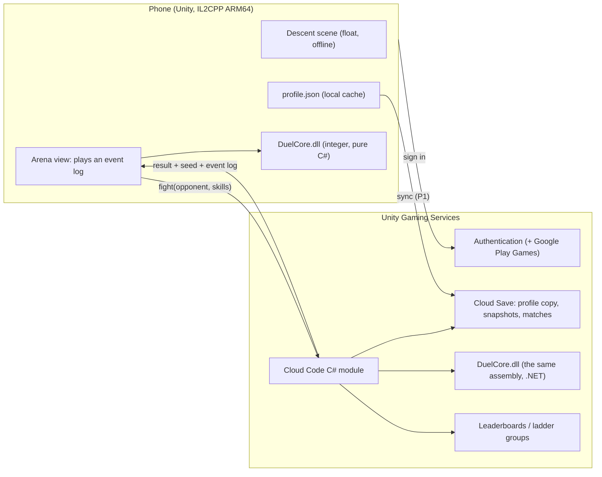

# 55 - The PvP arena: architecture decision (proposal, 2026-11-17)

A proposal for the owner's and the lead's decision. The owner asked "did we design the PvP architecture?": no, until
this document. docs/54 section 14 outlined an async arena in one paragraph and the lead kept it an outline until the
owner confirms it (docs/54 section 17, decision 12). Nothing in the game is built: no code under `Assets/`, no asset,
scene, setting or package changed. One tool is added so the questions that numbers can settle are settled:
`Tools/CombatChecks/ArenaDuel.cs`, a 400-line **integer-only deterministic 1v1 duel** with a small autopilot on each
side, and `ArenaDuelResearch.cs` beside it (its replay test runs in every plain `dotnet test`; the research runs by name,
section "How to re-run"). Numbers cited as "measured" come from it (2026-11-17, main `0243c55d`, seeds 1-2000, this
12-thread Windows machine); costs are the vendors' published prices on the day (sources at the end); every other number
is a starting value.

The earlier docs said "no PvP, no server authority, no live backend" for the MVP (docs/00, docs/01, docs/16) and named
the conditions for a backend (docs/06, "Backend decision": account sync, server-validated purchases, anti-cheat with
financial impact, competitive leaderboards). A ranked arena is exactly those conditions arriving together, which is why
this document is mostly about **what must leave the phone, and when**.

## 0. The short version

| Question | Answer | Key numbers |
|---|---|---|
| Real-time or async? | **Async now, real-time never unless the game grows** (hybrid only as a door left open) | real-time 1v1 needs about **370 players online at every hour** (55 of them in the arena) to match 9 in 10 within 15 s with 6 queues: roughly **110,000 MAU**; async works with **1 player and seeded rivals** |
| What the fight is | **1v1 hero duel, best of three, both sides played by the autopilot** (Archero 2's arena shape), the attacker's 3 skills chosen before the fight | a duel lasts **~27-30 s** (measured, health x8 in the arena); a best of three ~1.5 min |
| Second mode | **The Daily Trial**: everyone plays the same seed (Slay the Spire's Daily Climb), a leaderboard, unranked | costs nothing to build on the shipped Descent; ranked only after the combat core is integer (section 3.3) |
| Why the deterministic sim matters | the server **runs the duel itself**: the result is the server's, the client plays the event log; a replay is **(rules version, seed, two snapshots)** plus a ~1 KB event log | a duel **50-120 us**, a best of three **0.15-0.3 ms** of one core (measured; up to 4x that on a loaded machine): **1 million fights = about 4 CPU minutes** |
| Gear in ranked | **Not raw.** In a build-against-build auto fight a small edge decides almost everything | +5.6 % gear power wins **69-77 %**, a +5 set (+15 %) **90-99 %**, a +9 set **99 %+** (measured, mirror matches) |
| Backend | **Unity Gaming Services**: Authentication (+ Google Play Games), Cloud Save, **Cloud Code C# modules** (the same duel assembly on the server, .NET), Leaderboards | **$0** at 1k MAU, **~$5** at 10k, **~$100-160** at 100k a month (modelled, section 4.2) |
| What leaves the phone | for a **normalised** ranked arena: only the arena's rating, snapshots and rewards; for a **gear-counts** arena: gold, items, basma, efsun, materials, boosters, the anvil's stream, purchases | the second is a 20-25 day project and makes the anvil online-only |
| Phases | **P0** local arena vs generated rivals (no server) - **P1** accounts + cloud save (+ server-owned inventory only if gear counts) - **P2** async ranked ladder with server re-sim - **P3** real-time, optional | P0 **12-15 days**, P1 **8 days** (sync) or **25-30** (server-owned), P2 **15-20 days**, P3 **20-30 days** (one agent + the lead) |

**The recommendation in one paragraph.** Build the arena as an asynchronous 1v1 hero duel whose fight is computed by a
small integer duel core that lives in the game's pure C# (beside `RunRandom` and the shipped rules), compiled unchanged
into a Unity Cloud Code C# module, so the server decides every ranked result and the phone only draws it. Start with a
local arena against generated rivals (P0, no server, ships in the APK), add accounts and cloud save (P1), then the
ranked ladder (P2). Keep gear out of ranked fairness - a normalised or tightly bracketed ladder - unless the owner wants
gear to count there, in which case the economy of docs/54 moves to the server first. Real-time stays a door: the same
integer core runs lockstep over a relay if the game ever has the population.

## 1. The options and what they cost a solo developer

### 1.1 Real-time PvP

| Stack | What it is | Cost to us | Fit |
|---|---|---|---|
| **Unity Netcode for GameObjects + Relay** | Unity's networking, host/client or dedicated; Relay forwards traffic | Relay: first 50 average CCU free, then **$0.16 per average CCU**; dedicated hosting has no Unity home since **Multiplay was deprecated on 2026-04-01** (Matchmaker, Relay and Lobby continue) | state sync is wrong for a 60 Hz deterministic horde; a duel could be host-authoritative, which is cheatable |
| **Photon Fusion / Quantum** | Fusion: state sync with prediction; Quantum: deterministic fixed-point ECS with rollback, server-side input relay | **100 CCU free** (Fusion/Quantum only), 500 CCU **$125/month**, 1,000 **$250**, 2,000 **$500**, then about $0.50 per CCU | Quantum is the industrial version of what we already do (deterministic, fixed point) but the combat would be **rewritten in Quantum's ECS**: months, and a second copy of every rule |
| **Mirror / FishNet** | open-source Unity networking | free; you host the server (a VPS or Edgegap at ~$0.03-0.07 per vCPU-hour) | the server, its uptime and its anti-cheat are ours |
| **Nakama** | open-source game server (accounts, matchmaker, authoritative matches in Go/TypeScript/Lua) | self-hosted: a VPS and Postgres; Heroic Cloud prices by CPU (about **$13.33 a CPU-day** on AWS Marketplace, ~$400/month a CPU) | authoritative match code is **not C#**: the duel core would be ported |

What real-time asks that async does not:
- **Latency on phones.** Field measurements put 4G round trips at 25-95 ms with 12-24 ms jitter. A melee duel
  under rollback or input delay is playable but must be designed for it; our combat (auto-attacks, a joystick, one
  ability button) would feel the delay in the joystick first.
- **Rollback or prediction** in the scene, and a **server that simulates** to stop a modified client: hosting that runs
  every live match.
- **Population.** A 1v1 queue needs another compatible player to arrive while the first waits. With a 30 s fight and
  30 s between fights, a 15 s wait and 6 queues (3 brackets x 2 regions), 9 matches in 10 need a queue entry every
  6.5 s in each queue (1 - e^(-15/6.5) = 0.9): about **55 players in the arena, 370 online at 15 % in the arena - at
  every hour**, and the off-peak trough is about a third of the peak. Modelled as a mobile game typically runs (DAU 20 %
  of MAU, 30 minutes a day, a peak 2.5x the mean, so peak CCU is about 1 % of MAU), that is about **110,000 MAU**; with
  tighter skill matching (20 queues) about 350,000. Awesomenauts' developer
  estimated far more for team games; a hosting vendor's guidance puts a 100-CCU game at 15-minute waits. Below that
  population the queue fills with bots - an async fight in disguise.
- **Anti-cheat** for a client that sends inputs, **matchmaking**, regions, reconnects, and a match that cannot be
  paused when the phone rings.

For a solo developer with no live audience yet, real-time is a second game to build and to staff. It is not
recommended now (question 1).

### 1.2 Async PvP: what the genre actually ships

| Game | Shape | Who plays the defender | Where the fight is decided | Lesson for Cryptforge |
|---|---|---|---|---|
| **Archero 2** (Habby) | Arena: 1v1 against another player's setup, **automatic**, **best of three**; each round both sides get **three random skills of the same quality**; gear and runes count; tickets; weekly seasons with groups of 50-200 and promotion/demotion | the game's AI | not published | the closest reference: a survivor-like's PvP is an auto-duel you watch, made varied by dealt skills; gear counting makes it a spending contest |
| **Hero Wars** (Nexters) | Arena teams, battles automatic | AI | **the server calculates the result; the battle shown is a recording** (Nexters support) | the server-authoritative async model, stated by a shipped game |
| **AFK Arena** (Lilith) | Arena of Heroes: a defence formation and an attack formation, a season timer, replays of losses | AI | not published | replays as a learning tool |
| **Summoners War** (Com2uS) | Arena, Siege, Guild Battles all asynchronous: set a defence, attack others' AI-controlled defences; season ranking | AI | not published | async scales to a 10-year game |
| **Raid: Shadow Legends** (Plarium) | Classic Arena 4v4 against a pre-selected defence; tiers Bronze to Platinum; AI settings per defence | AI (configurable) | not published | the defender's AI policy is part of the build |
| **Clash of Clans** (Supercell) | attack a base; replays are **re-simulated from the recorded actions**, not video; a 2026 replay bug came from boosts the replay did not register | the base's rules | the live result is authoritative, the replay a re-run | a replay is inputs plus a deterministic simulation; anything outside the simulation (a boost) breaks it |
| **Diablo Immortal** (Blizzard) | real-time Battlegrounds with **stat compression** and a capped Combat Rating, still widely called pay-to-win | players | servers | compression alone does not make gear-based PvP fair |
| **Slay the Spire** Daily Climb, **Puzzle & Dragons** Ranking Dungeons | everyone plays the **same seed** (or dungeon); a score leaderboard; rewards by percentile | - | the client's claim; P&D disqualifies abnormal scores | the "race" is the cheapest fair mode there is; the risk is cheated scores |
| **Vampire Survivors, Megabonk** (docs/40) | no PvP | - | - | the genre's core does not need PvP; it is a retention layer |

### 1.3 The hybrid

Async now and real-time later is cheap **only if** the fight runs on a deterministic integer core from day one: the
same core then runs **lockstep** (both phones simulate, only inputs travel) over a cheap relay (Unity Relay, $0.16 per
CCU past 50), with a server re-running the inputs for disputes. In a duel where the autopilot moves and strikes and the
player's only inputs are three skill buttons, lockstep's input delay (100-150 ms) is invisible: nobody aims. A float
core cannot do this across x64 and ARM (section 2.2). So P0's integer core is also the real-time option's price of entry.

## 2. Why our deterministic simulation matters

### 2.1 What it buys

1. **The server decides, the phone draws.** In an auto-duel neither side sends inputs during the fight. The server
   takes the attacker's snapshot, the defender's snapshot and a seed it draws itself, runs the duel, stores the result
   and returns the event log; the phone animates the log. There is nothing to cheat in the fight: a modified client can
   only change what it shows itself.
2. **Cheap.** Measured: a duel of ~27 s costs **50-120 us** of one core (the spread is this machine's load), a best of
   three with dealt skills **0.15-0.3 ms** (up to 4x that while the machine was busy). A million ranked fights a month is
   about **4 CPU minutes**. On Cloud Code the invocation's overhead, not the fight, is the bill (section 4.2).
3. **Replays are data, not video.** A duel is (rules version, seed, attacker snapshot, defender snapshot); its event log
   is about **125 events, ~1 KB**. "Watch the replay" is "play the log" - the same view as the live fight.
4. **The same tests.** The duel core is pure C#, so `Tools/CombatChecks` measures the arena the way it measures the
   Descent: round-robin matrices of every hero and skill, the gear curve, a patch's effect on stored results.
5. **Bit for bit.** Measured: 2,000 duels sequential and again in parallel give 2,000 identical fingerprints (the
   replay test pins 200 in every plain `dotnet test`).

### 2.2 Why integers (and why the Descent's simulation is not the arena's core)

The Descent's simulation (`DescentSimulation`) is a **float** mirror of the scene, kept honest by
`SimulationParityTests` with a 1-point health tolerance. That is right for balance research and wrong for verification:
- Unity does not promise float determinism across architectures; IL2CPP keeps single precision where Mono promotes to
  double, and Unity's issue tracker shows Mono and IL2CPP disagreeing on Apple Silicon. A server re-simulating on x64
  .NET what a phone played under IL2CPP on ARM64 can drift, and a horde fight is chaotic: one different target and the
  runs part. The project paid for this once already (docs/21, the movement budget; `RunRandom`'s note).
- Photon Quantum, the industrial deterministic engine, uses fixed point for exactly this reason.

So the **arena's core is integer-only** (milli-points, milli-units, 60 ticks a second, chances per mille, `RunRandom`
streams). The prototype shows it is small: one file, no allocation in the loop. The Descent's float simulation stays the
balance tool.

Where a float core is enough: when the server computes and the phone only plays the server's log, cross-architecture
determinism is not needed at all. The integer core is needed for **(a)** an offline/local arena whose results a server
later trusts, **(b)** player inputs during the fight (tapped skills, real-time lockstep), **(c)** re-running old matches
on a newer server. All three are in the plan, and integers cost nothing extra in a 400-line core.

### 2.3 Anti-cheat for local saves: what must move before ranked

Today the profile is `profile.json` beside the app (`ProfileStore`, `JsonUtility`, version 3; docs/54 proposes version
4 with items, materials, boosters and the anvil's stream). It is plain JSON: anyone who can read app storage can give
themselves 39,491 gold, a +9 set or the next anvil draw (docs/54 4.3: `anvilSeed` and `anvilDraws` in the profile make
the next roll predictable to whoever reads the file).

What must be server-owned depends on **whether gear counts in ranked** (question 5):

| If ranked is... | Must be server-owned | Can stay local |
|---|---|---|
| **Normalised** (gear does not change the duel's stats; build = hero, weapon, 3 skills, arena talents) | the arena's rating, tickets, snapshots, match history, arena rewards and their ledger | gold, items, basma, efsun, materials, boosters - PvE is single-player and stays offline |
| **Gear counts** (raw, compressed or bracketed) | everything that makes gear: **gold, items, basma levels and pity, efsun lines, materials, boosters, the anvil's seed and draw count (server-only), purchases**; and **run rewards**, claimed through the server with plausibility caps | settings, cosmetics, telemetry |

The second column of the second row is the hard part: a run is played on the phone, by the scene, with a joystick, and
cannot be re-simulated by the server (2.2). Its rewards can only be **bounded**, not verified: gold per completed run
is measured at about 500 with a P25-P75 of ±10 (docs/54 section 1), items about 1.5 a run, a run lasts at least ~7
active minutes, so the server caps a claim by floors cleared and elapsed time, rate-limits runs, and flags outliers. That
is the standard defence of single-player-with-PvP mobile games and it is imperfect. The anvil and efsun rolls move
to Cloud Code (the server holds the stream; the phone never sees the seed), and **the anvil becomes online-only**.

**Purchases.** Any real-money purchase of currency or power needs receipt validation on a server regardless of PvP
(docs/06's own condition). If the owner plans IAP (question 3), P1's server-owned inventory is needed anyway and the
choice above is cheaper to make once.

## 3. The arena's gameplay

### 3.1 Four shapes, scored

| Shape | Fair? | Readable on a phone? | Cost | Verdict |
|---|---|---|---|---|
| **1v1 hero duel** (snapshot vs snapshot, both autopiloted, best of three) | as fair as the stat rule (3.4) | yes: two heroes, two bars, three skill call-outs, ~30 s a round | small: integer core, a lane, playback of existing hero art | **recommended** |
| **1v1 with each side's horde** (my horde attacks you while yours attacks me) | hard to balance; the horde's 30-40 crowd is the Descent's tuning | no: two crowds on one 1080-wide portrait screen | large: a second horde balance, a float sim to port to integers | no |
| **Race: who clears the same seeded wave faster** | the fairest: same seed, same content, your hands and build | yes: it is the game itself, with a ghost bar | **zero** to build unranked (the Descent and its seeds exist); ranked needs the whole combat in integers | **yes, as the unranked Daily Trial** (3.3) |
| **3-hero teams** (AFK Arena, Raid) | as 3.4 | crowded with three a side | needs heroes we do not have (two shipped, the Riftblade proposed, docs/46) | later, if the roster grows to 6+ |

### 3.2 The duel, as proposed

- **The lane.** A straight lane 12 units wide (the prototype's), the heroes entering at ±4; melee closes, the staff keeps
  its reach. Health x8 for both sides (an arena-only knob: a run's hero dies to a level-1 foe in 5 s, no duel should),
  a 90 s limit, the larger share of health left winning at the limit.
- **Both sides autopiloted**, as the async genre does it. The attacker chooses **3 active skills** before the fight: the
  hero's own ability plus two (docs/54 section 14's second and third skills); the defender's are its saved snapshot's.
  P2b can let the attacker **tap its own skills** during the fight (inputs recorded as tick numbers, verified by the
  server's re-run): the one live decision that makes watching a fight playing it.
- **Best of three, each round dealing both sides two skills of the same quality from a shared pool** (Archero 2's
  device), so two equal builds do not replay the same fight. Measured: it softens the gear curve only a little (3.4);
  its job is variety, not fairness.
- **What makes it readable**: the skill call-out over the caster (name, icon, 0.8 s), a damage number on a crit, two
  health bars with the shield drawn over them, a round counter, and after the fight a 3-line "why": "Bulwark absorbed
  1,140", "Cleaving Arc crit twice", "Ilya kited 6 s". The event log already holds all of it.
- **The defender's policy** is part of its build (Raid's AI settings): careful (shield early) or bold (skills on
  cooldown) - two of the autopilot's existing cohort habits.

**The first balance finding (measured): PvE balance is not PvP balance.** At equal gear the Vanguard beats Ilya in
**98-100 %** of duels (her kiting runs out of lane; the Sword's 22.5 DPS beats the Staff's 21.8 on 10 % more health).
Every arena needs a second balance table - per-hero arena coefficients (health, damage, reach in the lane) tuned by
a round-robin matrix in `CombatChecks` - and every new hero or skill pays that tuning again. It is a recurring cost,
not a one-off.

### 3.3 The Daily Trial (the race)

Everyone gets the same seed each day (and a weekly one with a modifier), plays one floor or the whole Descent with any
hero, and posts a clear time to a leaderboard; rewards by percentile, cosmetic. It costs a seed derived from the date
(`RunSeeds`), one leaderboard and a result screen line. It is **unranked by design** until the combat core is integer
(2.2): a human-played run cannot be re-simulated, so the server can only cap implausible times (a floor-1 clear under
the measured fastest) and Slay the Spire's own Daily Climb shows the leaderboard will attract cheaters. Measured, the
Descent's floor 1 re-simulates in **~0.5 s** of one core with identical results in parallel, so verifying an
**autopiloted** race (your build, your autopilot, the same seed) is affordable even now - a "ghost race" variant if the
owner wants a race that ranks.

### 3.4 Gear in a build-against-build fight (measured)

A geared side A against an ungeared B, 2,000 seeds a cell, draws counted half; the gear sets are docs/54 section 7.2's,
the power its index (DPS x EHP - 1):

| A's gear | Gear power | Vanguard mirror: duel / Bo3 | Ilya mirror: duel / Bo3 | Ilya (A) against the Vanguard: duel / Bo3 |
|---|---|---|---|---|
| none | 0 % | 49.5 % / 48.6 % | 48.3 % / 49.2 % | 0.2 % / 1.9 % |
| a small edge (+2 % damage and health) | +5.6 % | **72.7 % / 68.9 %** | 77.1 % / 75.3 % | 1.4 % / 6.9 % |
| all four at +5 | +14.7 % | **98.7 % / 90.4 %** | 95.6 % / 91.3 % | 11.5 % / 20.7 % |
| all four at +7 | +21.0 % | 99.9 % / 96.4 % | 98.8 % / 97.3 % | 34.3 % / 40.8 % |
| all four at +9 | +30.9 % | 100 % / 99.3 % | 100 % / 99.1 % | 76.6 % / 71.4 % |
| +9 with good efsun | +41.9 % | 100 % / 99.9 % | 100 % / 99.9 % | 97.3 % / 91.8 % |
| the ceiling | +50.6 % | 100 % / 100 % | 100 % / 100 % | 99.7 % / 97.3 % |

An auto-fight **amplifies** a stat edge: there is no outplay to cancel it. A +5 set (about 7 careful runs of gold and
Ember Shards, docs/54 4.1) wins 9 fights in 10 against an ungeared player; a +9 set (135 runs) wins all of them. docs/54 section 14's
matchmaking by "gear power bands of ±10 %" would still hand the stronger side **70-85 %**. Dealt skills (Bo3) move
it a few points. Three ways out:

1. **Normalised ranked** (recommended): the duel ignores gear's stats; the build is the hero, its weapon, three skills
   and a few arena talents unlocked by playing. Gear shows as cosmetics in the arena. No pay-to-win, and the local
   save's economy never touches fairness (2.3).
2. **Brackets**: gear counts, matchmaking within **±3 %** gear power (the small edge's ~70 % at 5.6 % is the ceiling of
   "fair enough"), leagues per bracket. Splits a small population six ways and needs server-owned gear.
3. **Compressed**: gear counts at a quarter in the arena, capped at +10 % (Diablo Immortal's stat compression). A +10 %
   edge still wins ~85 %; compression postpones the problem rather than solving it.

An **Open arena** (gear counts, casual rewards only, matchmaking by gear power) can sit beside a normalised ranked
ladder for players who want their +9 to matter (question 5).

### 3.5 Leagues, seasons, rewards

- **Weekly leagues in groups** (Archero 2: groups of 50-200, promotion and demotion each week): a group is formed from
  whoever is active this week, so it works at any population; a hidden Glicko-2 rating picks opponents (3-5 offered,
  refreshable), **5 tickets a day**.
- **Seasons of 4 weeks**, aligned with balance patches (3.6): a season's ranking, a frame or title, a weapon skin.
- **Rewards that feed PvE without inflating it**: cosmetics first; then the boosters docs/54 already prices, in bounded
  amounts - a week's top group about **2 Forge Seals and 3 Efsun Scrolls** (a careful run earns 0.43 Seals and 0.97
  Scrolls, so a week's best is about 5 runs' worth of boosters, and the Seal's bonus, not its count, is the knob -
  docs/54 section 5); **no gold beyond small amounts, no items, no materials** (materials are the depth gate, docs/54
  4.2). The arena must never be a faster road to +9 than the Descent.
- Bots (generated rivals at fixed gear powers, section 6's P0) fill a group below 20 real players and are labelled.

### 3.6 Versioning: a match must replay identically after a balance patch

Measured: a **2 % Sword patch changes the winner of 3.0 %** of stored Vanguard mirror duels and **9.4 %** of the closest
cross-hero pair, and the fingerprint of every one. So "a replay is the seed and two builds" is only true with the
**rules version** pinned:

- A **snapshot stores ids and levels**, never resolved stats (hero, weapon, the three skill ids, gear ids, basma levels,
  efsun line ids and tiers - docs/54's save already stores a line's tier, not its value). A defender's snapshot is
  **re-resolved at fight time** under the current rules, so a nerf applies to every defence at once.
- A **match stores** the rules version, the rules' content hash, the seed, both **resolved** snapshots (a few hundred
  bytes), the result and the **event log**. Watching an old replay plays the log - no re-simulation, any client version.
- The **duel core is versioned** (`DuelRules.Version`, an integer bumped by any change that can move a result) and the
  server keeps the current and the previous season's core loadable, for audits and disputes within a season.
- The **event log's schema is versioned separately** and changes rarely; an old client that cannot read a newer log
  is told to update.
- A season starts on a rules version and ratings carry over with a soft reset; balance patches land between seasons
  where possible.

## 4. Backend options for async and accounts

### 4.1 What we need

Accounts (anonymous first, linked to Google Play Games), a cloud copy of the profile, server code that can run **our C#
duel core**, small JSON documents (snapshots, matches), leaderboards or a ladder, and later receipt validation.
Offline play must keep working: the Descent never needs the network; only the arena and (if gear counts) the anvil do.

### 4.2 Monthly cost (modelled)

Usage model per daily player per day: 30 server calls (5 fights, 3 opponent lists, 10 anvil/efsun, 4 run claims, 8
other), 0.1 s of compute each, 15 save writes and 30 reads, ~30 KB stored a player; DAU = 20 % of MAU; 30 days.

| Option | 1k MAU | 10k MAU | 100k MAU | Runs our C# core? | Notes |
|---|---|---|---|---|---|
| **Unity Gaming Services** (Auth, Cloud Save, Cloud Code, Leaderboards) | **$0** | **~$5** | **~$100-160** | **yes**: Cloud Code C# modules on .NET (up to 9), no `UnityEngine` | Authentication free; Cloud Code 1M calls and 20 compute-hours a month free, then $1.50/M and $0.00002/s; Cloud Save 1M writes and reads free; Leaderboards free "for a limited time" (a localised page lists 50k MAU free, then $0.00125 a MAU: up to ~$60 of the 100k figure); module limits 256 MB, 10 MB a module |
| **PlayFab** (pay-as-you-go) | ~$0-5 | ~$15-25 | ~$150-200 | yes (CloudScript on Azure Functions, C#) | development mode is now **1,000 lifetime players a title**; profile writes $7.15 per million 1-KB blocks dominate; the Azure Functions app is a second bill |
| **Firebase** (+ Cloud Run for C#) | $0 | ~$0-5 | ~$45-80 | via a Cloud Run container | Auth free for most providers; Firestore ~$0.18 per 100k writes; Functions 2M calls free then $0.40/M (Node/Python); no ladder service: we build it |
| **Supabase** | $25 | $25 | ~$25-60 | no (Edge Functions are TypeScript): a separate C# host +$5-30 | Pro plan $25 includes 100k MAU and 2M function calls; Postgres is a real database |
| **Nakama** | ~$10-40 self-hosted | ~$10-40 | ~$40-80 + ops | no (Go/TS/Lua): port the core | Heroic Cloud ~$400 a CPU-month: too large for us |
| **Own minimal server** (ASP.NET Core minimal API + Postgres on a VPS) | ~$10-20 | ~$10-20 | ~$30-60 | **yes, natively** | cheapest at scale; every security patch, backup, TLS renewal, DDoS and 3 a.m. outage is ours: +10-15 days to build and a standing monthly cost in time |
| *Real-time, for comparison:* Photon Fusion/Quantum | free (100 CCU) | free-$125 | $125-250 | Quantum only (its own FP ECS) | plus the rewrite (1.1) |

**Recommendation: Unity Gaming Services.** It is the only managed option where the **same C# assembly** runs on the
phone and on the server without a port; it is free at our current scale, around $5 at 10k MAU and around $150 at 100k;
its Authentication supports Google Play Games sign-in (the Play Games v2 SDK signs in silently at launch; Unity's
`SignInWithGooglePlayGamesAsync` creates or finds the player); and it is in the editor the project already uses. The
risks: vendor lock-in (Unity deprecated Multiplay in 2026 - services do get withdrawn), Leaderboards' price after the
promotion, and Cloud Code's per-call limits. Mitigation: the duel core and the ladder logic are plain C# with no UGS
types in them; a move to an own ASP.NET server is a host change, not a rewrite.

### 4.3 Players' data: GDPR, KVKK, Google Play

- **What we would store**: a pseudonymous player id, a display name, the Google Play Games link, snapshots, match
  history, rating, the profile copy; telemetry only if it is ever sent (today it never leaves the device, docs/10).
  No email, no real name, no location beyond a coarse region for matchmaking.
- **Google Play**: an app that lets users create an account must offer **deletion in the app and through a web link**
  (deactivation does not count) and declare it in the Data safety form. An anonymous UGS account counts once it syncs.
  P1 ships "Delete my account" in settings and a web form (a page with a form or an email address suffices).
- **GDPR** (EU players): a privacy policy naming the processor (Unity), the purposes (save sync, PvP), retention
  (match history 90 days, the account until deleted), export on request; the processor's data-processing terms.
  Under-16s: the game is not aimed at children; the store rating and the policy say so.
- **KVKK** (Turkey, where the developer and many players are): the developer is the data controller; storing on Unity's
  servers abroad is a cross-border transfer, which since the 2024 amendment (Law 7499, the regulation of 10 July 2024)
  rests mainly on **standard contracts notified to the Authority within 5 business days** of signing (fines are
  stated); VERBIS registration has thresholds and exemptions set by the Board - **to be checked with a Turkish privacy
  lawyer before P1 ships** (question 7). An aydınlatma metni (information notice) in Turkish beside the privacy
  policy.
- **Offline keeps working**: the profile stays on the phone as the cache; sync is "last writer wins per field, the
  server's arena data always wins"; no network, no arena, everything else as today.

## 5. The recommended architecture

### 5.1 Picture

- **One assembly, two hosts.** `Cryptforge.Arena` (a new asmdef with `noEngineReferences`, like the pure rules): the
  integer duel core, the snapshot resolver, the arena rules table, the event-log writer, `RunRandom`. Unity compiles it
  into the APK; the Cloud Code module references the same source files (a `.csproj` with `Compile Include`, as
  `Tools/CombatChecks` already does for the simulation); `CombatChecks` tests it. A CI check builds all three and
  compares fingerprints of a fixed batch of duels.
- **The phone never decides a ranked result.** Locally (P0) it runs the core itself; in ranked it plays the server's log.

### 5.2 Data model (Cloud Save documents; JSON, camelCase, versioned like the profile)

| Document | Key fields | Owner |
|---|---|---|
| `player` | `playerId`, `displayName`, `createdAt`, `region`, `consentVersion`, `playGamesLinked` | server (written by Cloud Code) |
| `inventory` (P1, only if gear counts) | docs/54's version-4 fields: gold, `items[]`, `weaponGear[]`, materials, boosters, `anvilDraws`; **`anvilSeed` server-only** | server |
| `snapshot` | `snapshotId`, `playerId`, `heroId`, `weaponId`, `skills[3]`, `gear[]` (ids, levels, line ids and tiers), `policy` (careful/bold), `rulesVersion`, `gearPower`, `createdAt`, `hash` | server (the client proposes, the server resolves and validates) |
| `match` | `matchId`, `seasonId`, `attackerId`, `defenderId`, both snapshot hashes and resolved snapshots, `seed` (server-drawn), `rulesVersion`, `rulesHash`, `inputs[]` (P2b taps), `winner`, `rounds[]`, `eventLog` (~1 KB, compressed), `ratingDelta`, `createdAt` | server; kept 90 days |
| `ladder` | `seasonId`, `league`, `groupId`, `playerId`, `rating`, `deviation` (Glicko-2), `points`, `wins`, `losses`, `ticketsLeft`, `ticketsResetAt` | server |
| `season` | `seasonId`, `startsAt`, `endsAt`, `rulesVersion`, reward table | server (config) |

### 5.3 API sketch (Cloud Code module endpoints)

| Call | Does | Phase |
|---|---|---|
| `Arena.SetDefence(heroId, weaponId, skills[3], policy)` | resolves the build from rules (and server inventory when gear counts), stores the active snapshot | P2 |
| `Arena.Opponents()` | 3-5 snapshots near the player's rating in its group, bots below 20 players; free refresh | P2 |
| `Arena.Fight(opponentSnapshotId, skills[3], inputs[]?)` | spends a ticket, draws the seed, runs `DuelCore` (best of three), stores the match, updates both ladders, returns result + seed + log | P2 |
| `Arena.Replay(matchId)` | the stored log | P2 |
| `Ladder.Group()`, `Ladder.Season()` | standings, rewards | P2 |
| `Profile.Sync(profileDelta)` | cloud copy of the local profile (PvE stays local-authoritative) | P1 |
| `Economy.Strike(itemUid, seal, hammer)`, `Economy.Efsun(itemUid, paidWith)` | docs/54's `AnvilRule`/`EfsunRule` on the server's stream | P1, only if gear counts |
| `Economy.ClaimRun(runId, seed, heroId, floors, activeSeconds, loot)` | plausibility caps, rate limit, credit | P1, only if gear counts |
| `Store.Validate(receipt)` | Google Play receipt check, grant | with IAP |
| `Account.Delete()` | erases every document of the player | P1 |

## 6. Phased plan (one agent + the lead; days of work, not calendar)

| Phase | Work | Size | Done when | Server cost |
|---|---|---|---|---|
| **P0 - local arena** | `Cryptforge.Arena` asmdef: the integer core grown from the prototype (skills from docs/54 14, the hero kits, arena coefficients); snapshots of the player's own builds; **generated rivals** at fixed gear powers and the player's past snapshots; the arena view (lane, the two heroes' existing puppets, bars, call-outs, Bo3) playing the event log; a local "ladder" of 30 rivals; round-robin balance research and the per-hero coefficients; telemetry `arena_fight` | **12-15 days** (core 3, view 5, UI 3, tuning and tests 3, device 1) | the owner plays 10 duels on the S23 and says whether watching is fun (the go/no-go for P2) | $0 |
| **P1a - accounts and cloud save** | UGS Authentication (anonymous + Google Play Games link), profile sync with offline cache, account deletion (app + web), privacy policy and KVKK notice, Data safety | **8 days** + the owner's legal admin | a reinstall restores the profile; deletion erases it | $0 at 1k MAU |
| **P1b - server-owned inventory** (only if gear counts in ranked, or IAP) | `inventory` on the server, migration of the local profile (once, capped), Cloud Code anvil/efsun/claim with plausibility caps, the anvil online-only, receipt validation if IAP | **+17-22 days** | a modified `profile.json` changes nothing on the server; the anvil's odds match docs/54 4.1 from server telemetry | ~$5 at 10k MAU |
| **P2 - async ranked ladder** | the Cloud Code module with `DuelCore` (same sources), snapshots, opponents, fight, Glicko-2, weekly groups, seasons and rewards, replays, bots, rate limits; the CI fingerprint check (phone build = server build); a closed test with ~50 players | **15-20 days** + a test week | 1,000 server fights match the phone's local re-run bit for bit; a season runs end to end | ~$5 at 10k, ~$100-160 at 100k MAU |
| **P2b - tapped skills** (optional) | the attacker presses its 3 skills; inputs travel as tick numbers; the server re-runs them | **5 days** | a tapped fight replays identically on the server | same |
| **P3 - real-time duel** (optional, from ~100k MAU) | lockstep 1v1 over Unity Relay with the integer core, input delay, reconnect = the autopilot takes over, a server re-run for disputes; or Photon Quantum (a rewrite, 60+ days) | **20-30 days** + live operations | 9 in 10 matched within 15 s at the trough | Relay $0.16 per CCU past 50 |
| **Daily Trial** (any time after P1a) | a date seed, one leaderboard, the result line; unranked, plausibility-capped | **3-4 days** | a day's board fills | Leaderboards (free today) |

Order: **P0 first and alone** - it costs no server, ships in the APK, and answers the only question that matters before
any backend money: is watching a duel fun on a phone? docs/54's phases 1-3 (items and the save's version 4) come
before P1b; the three active skills (docs/54 14) before P0's skill choice, or P0 starts with the hero's ability plus
two pool skills.

### 6.1 Risks

| Risk | Likelihood | Effect | Mitigation |
|---|---|---|---|
| Watching an auto-duel is not fun on a phone | medium | P2 is wasted | P0 is the gate; tapped skills (P2b) and the "why" summary |
| Gear makes ranked pay-to-win (3.4) | high if gear counts | reviews, churn | normalised ranked; an Open arena for gear |
| PvP balance drags every new hero and skill (3.2) | certain | a recurring tuning task | round-robin matrix in `CombatChecks`, per-hero arena coefficients separate from PvE |
| Cheated local saves reach the ladder | certain if gear counts and P1b is skipped | an unfair ladder | do not let gear count before P1b; normalised ranked needs no inventory |
| Phone and server cores drift | low with integers | wrong replays, disputes | one source set, CI fingerprint check, `DuelRules.Version` |
| A balance patch rewrites stored outcomes (3.6) | certain without pinning | disputes | matches store the log and the rules version |
| Vendor withdraws a service (Multiplay, 2026) | low-medium | migration | no UGS types in the core or the ladder logic |
| Population too small for a lively ladder | high at launch | empty groups | weekly groups of whoever is active, labelled bots, async needs one player |
| Legal: KVKK/GDPR, account deletion | certain once accounts exist | store rejection, fines | P1a's checklist and a lawyer's hour before launch |

## 7. Questions for the owner

1. **Real-time or async?** This document recommends **async** (an auto-duel the server decides) now, and real-time
   only if the game reaches ~100k monthly players. Do you want real-time at all, and does "you fight another player's
   saved hero, played by the AI" feel like PvP to you?
2. **What should the arena feel like?** (a) a **duel** of two heroes, best of three (recommended); (b) a **race** on
   the same seed (the Daily Trial; fair and cheap, unranked at first); (c) **teams** of three heroes later. Should the
   attacker **tap its own skills** during the fight (P2b), or only choose them?
3. **Monetisation.** Will the game sell anything for real money - currency, boosters, items, a battle pass, or only
   cosmetics and ad removal (docs/11)? Selling power or currency means server-owned inventory and receipt checks no
   matter what PvP does.
4. **Server budget.** Is about **$5 a month at 10,000 players and $100-160 at 100,000** acceptable, and do you accept
   Unity's services (accounts on Unity's servers abroad) over running our own server?
5. **Gear in ranked.** Should a +9 set win ranked fights? Measured, an auto-fight hands a +5 set 9 wins in 10 and a +9
   set all of them. Options: **normalised ranked** (gear does not count; recommended), **brackets** by gear power,
   or gear counts openly - and an **Open arena** where gear counts, beside ranked?
6. **Online-only anvil.** If gear counts, the anvil and efsun must roll on the server: no basma without a connection.
   Acceptable?
7. **Accounts and law.** Are you ready to publish a privacy policy and a KVKK notice, sign Unity's data terms, add
   "Delete my account", and pay for an hour with a Turkish privacy lawyer before accounts ship?

## 8. Questions for the lead

1. **The integer arena core** as its own asmdef (`Cryptforge.Arena`, no engine references), separate from the
   Descent's float simulation, which stays the balance tool. Agree?
2. **The server decides ranked results**; the phone plays the log; local runs only in P0 and for prediction. Agree?
3. **Snapshots store ids and levels**, re-resolved at fight time; matches store the rules version and the log (3.6).
4. **Per-hero arena coefficients** as a second balance table, tuned by a round-robin research in `CombatChecks`.
5. **P0 before any backend**, with the owner's S23 verdict as the gate for P2.

## 9. The owner's answers and the lead's decisions, 2026-11-18

The owner researched monetisation and arena fairness across nine games of the genre and the Turkish market
(`docs/research/2026-11-18_monetisation_and_arena_owner_report.md`, in Turkish) and answered section 7:

1. **Async, never real-time.** An auto-duel against another player's saved hero, decided by the server once ranked
   exists. P3 (real-time) is dropped from the plan.
2. **A duel, best of three. Automatic first:** the player chooses the build and watches. **P2b (tapped skills) is built
   if the owner's P0 verdict says watching is not fun.** The race (Daily Trial) and teams are not planned.
3. **Monetisation: model B** (docs/58): free, an optional rewarded video at the result screen only, one non-consumable
   "skip reward videos" product at about 99.99 TL. Gold, materials, boosters and efsun are never sold. Since nothing
   bought touches power, **no server-owned inventory** is needed for monetisation.
4. **Server budget:** not needed for the first release (P0 has no server). It is asked again before P1.
5. **Gear in ranked: normalised, with the build's identity kept**, as the owner's report proposes. The ranked duel keeps
   the hero, the weapon's type and attack pattern, the three skills and the **types** of efsun lines the player picks;
   the + level, the number of lines and every line's value are **the same for both sides**. The arena's efsun pool is
   **open to everyone**, so a line type is a loadout choice, not something owned: a rare roll or a +9 never decides a
   ranked fight. Beside it, an **Open arena** (gear counts in full, casual rewards only, matched by gear power).
   The fight's summary names the two or three effects that won it (async players cannot intervene, so the "why"
   matters).
6. **The anvil stays offline.** Follows from 5: nothing the anvil makes decides ranked, so basma and efsun never need
   a connection.
7. **Accounts and law:** not needed for the first release. Asked again before P1, with the privacy policy, the KVKK
   notice and the lawyer's hour.

**The release order:** the first release is the single-player Descent plus **P0, the local arena**: generated rivals and
the player's own past heroes, no server. It ships in the APK. Ranked against real players (P1-P2) follows once the
first release has players.

**The lead's decisions on section 8:** all five as written. The integer core is `Cryptforge.Arena` with no engine
references. The server decides ranked. Snapshots store ids and levels. Per-hero coefficients come from a round-robin.
P0 comes before any backend.

The normalised build of answer 5 refines section 3.4's option 1, which had gear as cosmetics only. P0 builds both modes
on the integer core: **ranked-normalised**, which is the default, and **open**.

## How to re-run

    dotnet test Tools/CombatChecks -c Release --filter "FullyQualifiedName~ArenaDuelTests"
      # the replay pin (200 duels sequential and parallel, identical fingerprints) and an even mirror; also in a plain run
    dotnet test Tools/CombatChecks -c Release --filter "FullyQualifiedName~ArenaDuelResearch"
      # ARENA_SEEDS (2000), ARENA_RACE_SEEDS (20); writes TestResults/arena-duel.md: replays, cost, the gear table,
      # the patch's effect on stored duels, the race's re-simulation of floor 1

The prototype's limits: one lane, no horde, two heroes at their run-start kits with a 10 % base crit, a pool of five
skills, a hand-written autopilot (close or keep reach, skills by health thresholds). Its numbers are the shape of the
problem (how steep the gear curve is, what a duel costs, how a patch moves stored results), not the arena's tuning.

## Sources

- Photon: [pricing documentation](https://doc.photonengine.com/photon/current/pricing) (100 CCU free for Fusion and
  Quantum, traffic per CCU), [Photon blog on pricing](https://blog.photonengine.com/multiplayer-pricing-made-simple/),
  [Crux, Photon Fusion pricing 2026](https://crux.supercraft.host/blog/photon-fusion-pricing-2026/) (500/1,000/2,000
  CCU at $125/$250/$500); [Quantum introduction](https://doc.photonengine.com/quantum/v2/quantum-intro) (deterministic,
  fixed point).
- Unity: [Gaming Services pricing](https://unity.com/products/gaming-services/pricing) (Authentication, Cloud Save,
  Cloud Code, Relay, Leaderboards), [the Spanish pricing page](https://unity.com/es/products/gaming-services/pricing)
  (Leaderboards 50k MAU free, then per MAU), [Cloud Code module limits](https://docs.unity.com/en-us/cloud-code/modules/reference/limits)
  and [overview](https://docs.unity.com/en-us/cloud-code/modules/overview) (.NET up to 9, no UnityEngine, 256 MB),
  [Multiplay deprecation notice](https://status.unity.com/info_notices/362941) and
  [Crux on the shutdown](https://crux.supercraft.host/blog/unity-multiplay-shutdown-where-studios-actually-went-2026/),
  [Google Play Games sign-in](https://docs.unity.com/en-us/authentication/platform-signin/google-play-games);
  Google, [Migrate to Play Games Services v2 (Unity)](https://developer.android.com/games/pgs/unity/migrate-to-v2)
  (silent sign-in at launch).
- Determinism: Unity Discussions, [State of determinism in Unity](https://discussions.unity.com/t/state-of-determinism-in-unity/867770)
  and [IL2CPP floating point on one architecture](https://discussions.unity.com/t/are-floating-point-numbers-deterministic-on-the-same-architecture-il2cpp/892251);
  Unity Issue Tracker, [Apple Silicon float inconsistencies between Mono and IL2CPP](https://issuetracker.unity3d.com/issues/apple-silicon-floating-point-inconsistencies-between-mono-and-il2cpp);
  Arm, [consistent floating-point results across x86 and Arm](https://learn.arm.com/learning-paths/cross-platform/floating-point-behavior/how-to-4);
  [Burst float determinism](https://docs.unity.com/en-us/engine/7000.0/manual/programming-environment/script-compilation/burst/compilation/float-precision-determinism).
- Backends: [PlayFab pricing](https://developer.microsoft.com/en-us/games/products/playfab/pricing/) (development mode
  1,000 lifetime players, meters), [AccelByte on PlayFab's free tier](https://accelbyte.io/blog/playfab-just-cut-its-free-tier-by-99.-heres-what-that-means-for-your-game);
  [Firebase pricing plans](https://firebase.google.com/docs/projects/billing/firebase-pricing-plans) and
  [Activepieces' Firebase pricing 2026](https://www.activepieces.com/blog/firebase-pricing-2026-plans-costs-and-free-limits.md);
  [Supabase pricing guide 2026](https://toolradar.com/blog/supabase-pricing-2026); [Heroic Cloud pricing](https://heroiclabs.com/pricing)
  and [Nakama on AWS Marketplace](https://aws.amazon.com/marketplace/pp/prodview-zfxkalyjehlh2); [Edgegap pricing](https://edgegap.com/pricing).
- Async games: [Theria Games, Archero 2 Arena](https://theriagames.com/?p=85626) (automatic, best of three, three
  random skills of one quality, weekly groups); Nexters, Hero Wars support (the server calculates arena battles; via
  search, the page refuses automated reading); [afk.guide, Arena of Heroes](https://afk.guide/arena-of-heroes);
  [Summoners War beginner PvP guide](https://gameplay.tips/guides/summoners-war-ultimate-beginners-guide-to-pvp.html);
  [HellHades, Raid arena](https://hellhades.com/understanding-the-arena-and-the-benefits-it-can-bring/);
  [Sportsdunia on the Clash of Clans replay glitch](https://www.sportsdunia.com/gaming/clash-of-clans-replay-glitch-april-2026)
  and [PiunikaWeb](https://piunikaweb.com/2026/05/04/clash-of-clans-out-of-sync-error-high-loot/);
  [Blizzard, Diablo Immortal season notes](https://news.blizzard.com/article/23994437/) (stat compression) and
  [Wowhead, is Diablo Immortal pay to win](https://www.wowhead.com/news/is-diablo-immortal-really-pay-to-win-327321);
  [PCGamesN, Slay the Spire daily challenge](https://www.pcgamesn.com/slay-the-spire/slay-the-spire-daily-challenge);
  [Puzzle & Dragons tournament notice](https://www.puzzleanddragons.us/single-post/hathor-tournament-250203) (percentile rewards).
- Population and latency: [Game Developer, the requirements of good matchmaking](https://gamedeveloper.com/design/the-requirements-of-good-matchmaking),
  [Joost van Dongen, why good matchmaking requires enormous player counts](https://sunlightf.blogspot.com/2014/11/why-good-matchmaking-requires-enormous.html),
  [Supercraft, matchmaking vs server browsers for indies](https://gsb.supercraft.host/blog/matchmaker-vs-server-browser-indie-games/);
  [PhoneArena, carrier latency and jitter](https://phonearena.com/news/verizon-t-mobile-att-5g-game-streaming-speed-latency-comparison_id124377),
  [CableFree, LTE latency](https://cablefree.net/wirelesstechnology/4glte/lte-network-latency/).
- Law and store: [Google Play, account deletion requirements](https://support.google.com/googleplay/android-developer/answer/13327111);
  [KVKK, yurt dışına aktarım](https://www.kvkk.gov.tr/Icerik/2053/Yurtdisina-Aktarim),
  [KVKK, standart sözleşmelerde dikkat edilecek hususlar](https://www.kvkk.gov.tr/Icerik/8170/Yurt-Disina-Kisisel-Veri-Aktariminda-Kullanilacak-Standart-Sozlesmelerde-Dikkat-Edilmesi-Gereken-Hususlara-Iliskin-Kamuoyu-Duyurusu),
  [Cottgroup, standard contract notification duty](https://cottgroup.com/en/blog/work-life/item/standart-sozlesme-bildirim-yukumlulugu-ve-yaptirimlari).
- In this repository: docs/06 (backend decision), docs/10 (local telemetry), docs/11 (monetisation), docs/14 (privacy
  checklist), docs/21 and `RunRandom` (the float lesson), docs/54 (items, the power index, section 14's outline).
